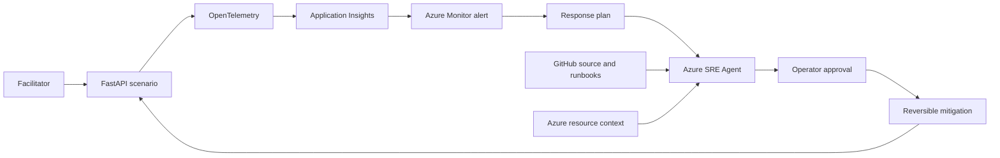

## Logical architecture

The sample fleet separates business context from runtime mechanics. Fifteen JSON
scenario definitions feed one typed application factory. The factory exposes the
same operational API, telemetry, and bounded fault controls for every industry.

## Deployment architecture

All samples share one Azure Container Apps environment, Log Analytics workspace,
and Application Insights resource. Each sample remains an independent Container
App so alerts, scaling, revisions, and investigation context retain a clear
service boundary.

One user-assigned managed identity pulls images from Azure Container Registry.
The Azure SRE Agent uses its own user-assigned managed identity. These identities
must not be conflated because workload execution and operational investigation
have different permission boundaries.

## Telemetry contract

Each service adds `service.name`, `service.namespace`, and deployment environment
resource attributes. FastAPI instrumentation produces request traces. The shared
business counter records application, outcome, and fault mode without storing
customer payloads.

## Failure model

| Mode | HTTP effect | Health effect | Investigation lesson |
|------|-------------|---------------|----------------------|
| Error | `/work` returns 500 | Healthy | Application failure |
| Latency | `/work` is delayed | Healthy | SLO degradation |
| Dependency | `/work` returns 503 | Healthy | Downstream outage |
| Not ready | Business path remains available | Readiness returns 503 | Routing and revision health |

## Trust boundaries

* Public application ingress terminates at Azure Container Apps.
* Fault controls require explicit enablement and a secret header.
* Workload identity is separate from SRE Agent identity.
* Source, telemetry, incident, and resource connectors are separately governed.
* Response plans and tool policies bound autonomous behavior.
* Production adoption should add private networking and central policy controls.

