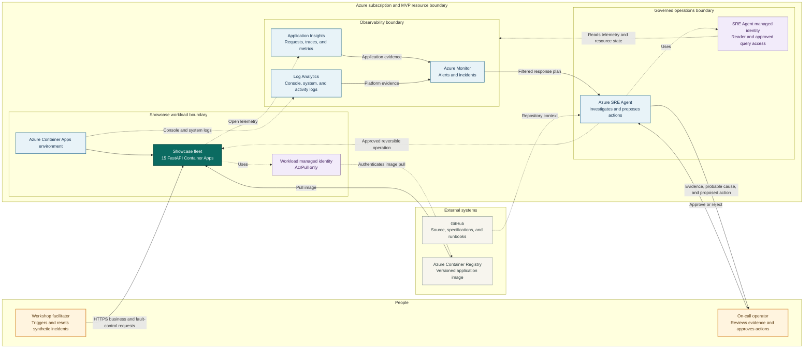
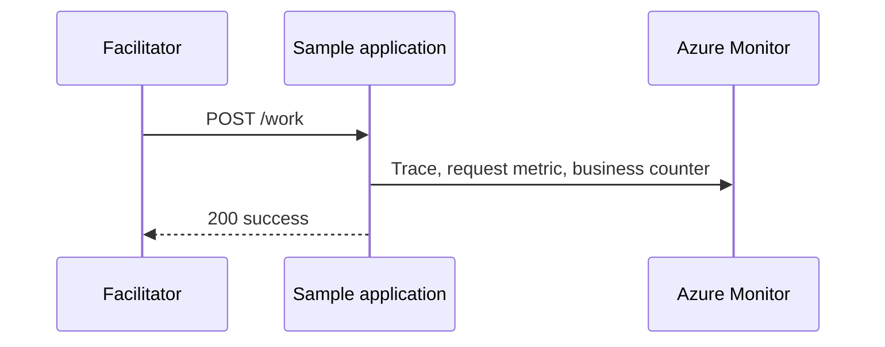
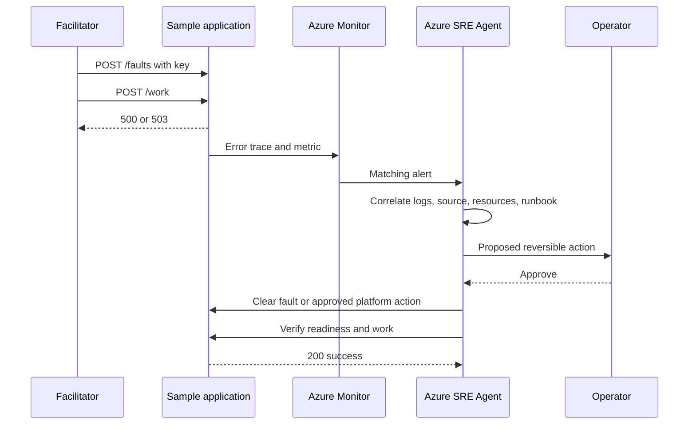

## Design goals

The system must produce repeatable operational evidence with minimal application
variation. It must make unsafe behavior difficult, support both local and Azure
execution, and expose enough context for Azure SRE Agent to distinguish process,
application, dependency, and latency failures.

## System context

The solid arrows show business, alert, and approval flows. Dashed arrows show
telemetry, identity, repository context, and governed operational access. The
workload identity can pull images only. Azure SRE Agent uses a separate identity
for read and monitoring access, and every write operation remains subject to the
response plan and operator approval.

## Component design

### Scenario catalog

The catalog scans `apps/*/*/scenario.json`, validates each object, rejects missing
or duplicate slugs, and returns stable ordering. Portfolio directories organize
ownership without changing application identity.

### Application factory

The factory creates:

* Metadata endpoint with SLO, domain, impact, and runbook
* Independent liveness and readiness endpoints
* Synthetic business operation with bounded units
* Fault-state read, activation, and clear endpoints
* OpenTelemetry instrumentation and business metrics

All applications run the same factory. The `APP_SLUG` environment variable
selects scenario context when a container starts.

### Fault controller

Fault state is process-local and protected by a lock. Activation stores mode and
UTC expiry. Read operations clear expired state before returning. Process restart
also clears state.

This design deliberately avoids durable chaos state. A workshop cannot leave a
fault active after the process is replaced.

### Telemetry

The runtime selects one exporter:

1. Application Insights when `APPLICATIONINSIGHTS_CONNECTION_STRING` exists
2. Generic OTLP when `OTEL_EXPORTER_OTLP_ENDPOINT` exists
3. In-process providers for local development without export

FastAPI instrumentation produces request spans and standard HTTP attributes.
The custom `showcase.business.operations` counter records application, fault
mode, and outcome.

### Azure platform

The complete MVP Bicep deployment uses two stages. The subscription-scoped
foundation creates the resource group, cost budget, registry, workload identity,
Log Analytics, workspace-based Application Insights, Container Apps environment,
and optional action group. After the shared image is built, the resource-group
workload stage creates 15 Container Apps plus alerts and availability tests for
the representative MVP applications.

Each application uses 0.25 vCPU, 0.5 GiB memory, zero minimum replicas, and two
maximum replicas. The existing-resource template remains available for
environments that already provide a registry and workload identity.

### Azure SRE Agent

The agent is deployed separately with Microsoft's official templates. Separation
keeps product lifecycle and connector configuration independent from disposable
showcase workloads.

## Request flows

### Normal operation

### Incident and recovery

## API design

| Method | Path | Purpose | Authentication |
|--------|------|---------|----------------|
| GET | `/` | Fleet landing page and application table | None |
| GET | `/api/metadata` | Scenario and business metadata | None |
| GET | `/health/live` | Process health | None |
| GET | `/health/ready` | Traffic readiness | None |
| POST | `/work` | Synthetic business operation | None in showcase |
| GET | `/faults` | Current synthetic fault | None |
| POST | `/faults` | Activate bounded fault | Enable flag and `X-Demo-Key` |
| DELETE | `/faults` | Clear fault | `X-Demo-Key` |

The full schema is stored in
`specs/001-enterprise-sre-agent-showcase/contracts/openapi.yaml`.

## Identity and authorization

### Workload identity

A user-assigned managed identity authenticates the Container Apps fleet to Azure
Container Registry. The identity requires `AcrPull` and no SRE Agent privileges.

### Agent identity

Azure SRE Agent receives its own user-assigned managed identity. Begin with
Reader access to the showcase resource group. Add Monitoring and Log Analytics
roles according to official setup guidance.

### Human identity

Only approved facilitators receive the demonstration key. Only SRE Agent
administrators configure global policies or hooks. Only designated operators
approve write actions.

## Security controls

| Threat | Control |
|--------|---------|
| Unintended fault activation | Disabled by default, secret key, 900-second maximum |
| Persistent service disruption | In-memory state, automatic expiry, scale replacement |
| Resource deletion | Global deny policy and no agent delete role |
| Secret exposure | Container Apps secret reference and deny secret-read tools |
| Excess Azure scope | Dedicated resource group and least-privilege RBAC |
| Unreviewed action | Review-mode response plan |
| Sensitive data exposure | Synthetic data and isolated telemetry |
| Supply-chain change | Lock file, Dependabot, CI, container build validation |

## Alert design

Create labeled alerts for:

* HTTP 5xx rate above the workshop threshold
* HTTP 503 dependency response rate
* Readiness probe failures
* Request duration above the scenario SLO

Alert titles must include `SRE-SHOWCASE` and the application slug. Response-plan
filters must require that prefix to avoid ingesting unrelated incidents.

## Scalability and limits

The applications scale from zero to two replicas. Because fault state is local,
a multi-replica scenario can produce mixed results. Workshops should keep each
application at one replica while demonstrating faults. A production chaos
platform would require coordinated, durable experiment state.

## Availability

The showcase uses one region and one shared observability plane. It does not
claim multi-region availability. The application SLOs are scenario context, not
service guarantees for this deployment.

## Data design

No business payload is stored. Scenario metadata is static JSON. Fault state is
ephemeral. Telemetry contains service identity, route, duration, status, fault
mode, and synthetic operation counts.

## Configuration

| Variable | Required | Purpose |
|----------|----------|---------|
| `APP_SLUG` | Yes | Select application scenario |
| `ENABLE_FAULT_INJECTION` | No | Expose activation control when `true` |
| `DEMO_API_KEY` | For fault changes | Authenticate activation and clear |
| `DEPLOYMENT_ENVIRONMENT` | No | Set telemetry environment |
| `APPLICATIONINSIGHTS_CONNECTION_STRING` | Azure | Export to Azure Monitor |
| `OTEL_EXPORTER_OTLP_ENDPOINT` | Optional | Export to another OTLP backend |

## Deployment and rollback

Deploy the MVP foundation, build one immutable image in the created registry,
then deploy the same digest to all 15 Container Apps. Configuration provides
application identity. Use Bicep what-if before each deployment stage. Rollback
changes the affected app to its previous healthy revision. Resource-group deletion
is reserved for planned teardown.

## Design decisions

| Decision | Rationale | Tradeoff |
|----------|-----------|----------|
| Shared runtime | Consistent evidence and low maintenance | Less framework diversity |
| Static JSON scenarios | Reviewable and tool-neutral | No dynamic catalog management |
| In-memory faults | Safe reset and no infrastructure mutation | Not coordinated across replicas |
| Separate agent deployment | Follow official lifecycle templates | Two deployment workflows |
| Public ingress for workshops | Simple access and alert generation | Production requires private design |
| Review mode first | Human accountability | Slower than autonomous remediation |

## Test design

Automated tests verify catalog count, uniqueness, runbook existence, every API
contract, fault disablement, fault activation, failure response, clearing, and
recovery. Ruff validates code. Bicep compilation and Compose parsing validate
deployment definitions. A live smoke test verifies real HTTP behavior.

## Known limitations

* The showcase has no durable business data.
* Faults are local to one process.
* Alert rules require environment-specific creation.
* Docker build requires a running Docker daemon.
* Azure end-to-end acceptance requires a subscription and deployed agent.
* Costs and product interfaces must be revalidated before each enterprise event.
