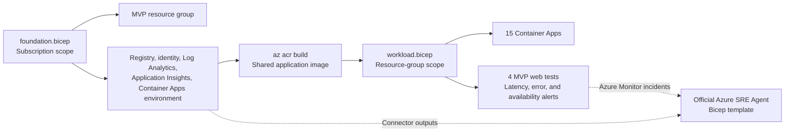

## Architecture



## Prerequisites

Install Azure CLI with Bicep support. Sign in to the intended non-production
subscription and register these resource providers when required:

* `Microsoft.App`
* `Microsoft.ContainerRegistry`
* `Microsoft.Insights`
* `Microsoft.ManagedIdentity`
* `Microsoft.OperationalInsights`
* `Microsoft.Consumption`

Set the active subscription and a secret that is not stored in source control:

```powershell
az account set --subscription "REPLACE_WITH_SUBSCRIPTION"
$env:DEMO_API_KEY = "REPLACE_WITH_RANDOM_SECRET"
```

## Stage 1: Deploy the MVP foundation

Copy [`foundation.bicepparam`](foundation.bicepparam) to an
environment-specific file. Replace the owner, email, cost center, expiry date,
and budget start date.

Preview the subscription deployment:

```powershell
az deployment sub what-if `
  --name "sre-mvp-foundation" `
  --location "westus2" `
  --template-file "infra/mvp/foundation.bicep" `
  --parameters "infra/mvp/foundation.bicepparam"
```

Deploy and capture its outputs:

```powershell
$foundation = az deployment sub create `
  --name "sre-mvp-foundation" `
  --location "westus2" `
  --template-file "infra/mvp/foundation.bicep" `
  --parameters "infra/mvp/foundation.bicepparam" |
  ConvertFrom-Json

$outputs = $foundation.properties.outputs
$resourceGroupName = $outputs.resourceGroupName.value
$registryName = $outputs.registryName.value
```

Foundation outputs include:

| Output | Consumer |
|--------|----------|
| `registryName` and `registryLoginServer` | Image build and workload |
| `workloadIdentityResourceName` and client ID | Container Apps |
| `applicationInsightsResourceName` and resource ID | Workload and SRE Agent |
| `applicationInsightsAppId` | SRE Agent Application Insights connector |
| `logAnalyticsResourceName` and resource ID | SRE Agent Log Analytics connector |
| `containerAppsEnvironmentResourceName` | Workload |
| `actionGroupResourceName` | Alert actions |
| `resourceGroupName` | Workload and agent RBAC scope |

## Stage 2: Build the application image

Use Azure Container Registry Tasks so no local Docker daemon is required:

```powershell
az acr build `
  --registry $registryName `
  --image "sre-showcase:latest" `
  .
```

Use an immutable version tag for a controlled evaluation instead of `latest`.
Update `imageNameAndTag` during the workload deployment.

## Stage 3: Deploy the fleet and monitoring

The parameter example contains readable placeholders. The command below uses the
actual foundation outputs so resource names cannot drift:

```powershell
az deployment group what-if `
  --name "sre-mvp-workload" `
  --resource-group $resourceGroupName `
  --template-file "infra/mvp/workload.bicep" `
  --parameters `
    registryName=$outputs.registryName.value `
    workloadIdentityName=$outputs.workloadIdentityResourceName.value `
    applicationInsightsName=$outputs.applicationInsightsResourceName.value `
    containerAppsEnvironmentName=$outputs.containerAppsEnvironmentResourceName.value `
    actionGroupName=$outputs.actionGroupResourceName.value `
    imageNameAndTag="sre-showcase:latest" `
    demoApiKey="$env:DEMO_API_KEY"

$workload = az deployment group create `
  --name "sre-mvp-workload" `
  --resource-group $resourceGroupName `
  --template-file "infra/mvp/workload.bicep" `
  --parameters `
    registryName=$outputs.registryName.value `
    workloadIdentityName=$outputs.workloadIdentityResourceName.value `
    applicationInsightsName=$outputs.applicationInsightsResourceName.value `
    containerAppsEnvironmentName=$outputs.containerAppsEnvironmentResourceName.value `
    actionGroupName=$outputs.actionGroupResourceName.value `
    imageNameAndTag="sre-showcase:latest" `
    demoApiKey="$env:DEMO_API_KEY" |
  ConvertFrom-Json
```

Omit `actionGroupName` when the foundation did not create an action group.

The workload template enables monitoring for four representative applications:

| Application | Fault class | Monitoring |
|-------------|-------------|------------|
| Retail Checkout | Dependency | Latency, errors, readiness |
| Order Fulfillment | Error | Latency, errors, readiness |
| Payments API | Latency | Latency, errors, readiness |
| Banking Ledger | Not ready | Latency, errors, readiness |

Change `monitoredApplicationSlugs` to adjust the monitored set. Every value must
match one of the 15 application slugs.

## Stage 4: Verify telemetry and alerts

Retrieve application URLs from the workload outputs:

```powershell
$applicationUrls = $workload.properties.outputs.applicationUrls.value
$applicationUrls | Format-Table name, url
```

For each monitored application:

1. Confirm `/health/live` and `/health/ready` return HTTP 200.
2. Submit baseline requests to `/work`.
3. Confirm `AppRequests` contains the expected `AppRoleName`.
4. Confirm `showcase.business.operations` reaches Application Insights.
5. Confirm console and system logs reach Log Analytics.
6. Confirm the standard availability test reports success from both locations.
7. Confirm latency and error alert rules are enabled.

Scheduled-query alerts require enough requests to meet
`minimumAlertRequestCount`, which defaults to 20.

## Stage 5: Deploy Azure SRE Agent

Use the official
[Azure SRE Agent Bicep template](https://github.com/microsoft/sre-agent/tree/main/sreagent-templates/bicep).
Map the foundation outputs to the official parameters:

| Official template parameter | MVP foundation value |
|-----------------------------|----------------------|
| `targetResourceGroups` | Array containing `resourceGroupName` |
| `accessLevel` | `Low` |
| `actionMode` | `Review` |
| `monthlyAgentUnitLimit` | MVP-approved AAU limit |
| `enableAppInsightsConnector` | `true` |
| `appInsightsResourceId` | `applicationInsightsResourceId` |
| `appInsightsAppId` | `applicationInsightsAppId` |
| `enableLogAnalyticsConnector` | `true` |
| `lawResourceId` | `logAnalyticsResourceId` |
| `enableAzureMonitorConnector` | `true` |

Connect this GitHub repository after the agent deploys. Keep deletion, secret
retrieval, and role-assignment operations denied. Use a response plan filtered
to alert display names beginning with `SRE-SHOWCASE`.

## MVP operating controls

* Keep `minimumReplicas=0` outside scheduled demonstrations.
* Set it to `1` only when live navigation speed is required.
* Keep fault injection disabled until a controlled exercise begins.
* Use an immutable image tag for customer-facing evaluations.
* Keep alert and availability scope limited to the representative applications.
* Delete the SRE Agent and showcase resource group when the MVP window ends.

## Validate Bicep locally

```powershell
az bicep build --file "infra/mvp/foundation.bicep"
az bicep build --file "infra/mvp/workload.bicep"
```

Compilation validates syntax and Azure resource schemas. Run `what-if` against
the intended subscription before every deployment.
