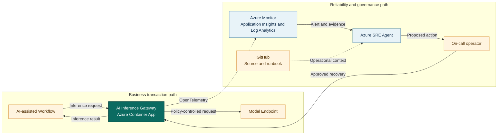

## Application overview

AI Inference Gateway routes synthetic inference requests to a model endpoint. It
represents a controlled access layer for AI-assisted workflows, provider policy,
and cost boundaries. Endpoint loss stalls dependent business processes.

| Attribute | Value |
|-----------|-------|
| Portfolio | Digital platforms |
| Business domain | Artificial intelligence |
| Business operation | `run-inference` |
| Critical dependency | `model-endpoint` |
| Availability objective | 99.9 percent |
| Latency objective | Under 1,200 ms |
| Demonstrated fault | Dependency unavailable |
| Business impact | AI-assisted workflows stall and user experience degrades |

The dependency fault returns HTTP 503 while gateway health may remain successful.
Prompts and outputs are synthetic and are not persisted.

## System context diagrams

The inference path keeps provider access behind the gateway. Azure SRE Agent
investigates endpoint and revision evidence without reading prompts, changing
models, or bypassing safety and cost controls.

## Azure resources for telemetry and investigation

| Azure resource or configuration | Requirement | Purpose |
|---------------------------------|-------------|---------|
| Dedicated resource group | Required | Isolates cost, RBAC, policy, alerts, and investigation scope |
| Log Analytics workspace | Deployed | Stores Container Apps console and system logs for 30 days |
| Workspace-based Application Insights | Deployed | Receives OpenTelemetry requests, traces, and custom metrics |
| Container Apps environment | Deployed | Sends application and platform logs to Log Analytics |
| AI Inference Gateway Container App | Deployed | Provides revision, replica, ingress, probe, and scaling evidence |
| Azure Container Registry | Supporting | Stores the shared image used by the application revision |
| Workload managed identity | Supporting | Pulls the image with `AcrPull`; it has no model access |
| Azure Monitor alert rules | Add | Detect endpoint errors, latency, and SLO breaches |
| Application Insights availability test | Add | Tests `/health/ready` externally; not in current Bicep |
| Azure SRE Agent and agent identity | Deploy separately | Investigates with approved read access in Review mode |
| Azure Monitor and GitHub connections | Configure separately | Supply incident, source, metadata, and runbook context |
| Activity Log diagnostic setting | Recommended | Retains deployment and control-plane events |
| Action group and Key Vault | Recommended | Notify humans and protect demonstration secrets |

### Required AI Inference Gateway signals

| Signal | Evidence to collect |
|--------|---------------------|
| Request telemetry | `POST /work`, status, duration, operation ID, and `service.name=ai-inference-gateway` |
| Business metric | `showcase.business.operations` with outcome and fault mode |
| Application log | `dependency_unavailable` with `dependency=model-endpoint` |
| Health | Liveness, readiness, and external availability |
| Platform | Revision, replica, ingress, scaling, deployment, CPU, and memory |
| Dependency | Add model-client spans, safe token counts, throttling, and endpoint metrics in production |

Prompts, outputs, embeddings, model credentials, personal data, and proprietary
content must remain outside telemetry and SRE Agent context.

## Step-by-step telemetry configuration

1. Create a dedicated resource group with AI governance ownership, budget, policy,
   and access review.
2. Create Azure Container Registry and a workload identity with only `AcrPull`;
   use a separate identity for any production model access.
3. Deploy Log Analytics with approved retention and restricted access.
4. Create workspace-based Application Insights linked to the workspace.
5. Create the Container Apps environment and route platform and console logs.
6. Deploy AI Inference Gateway with `APP_SLUG=ai-inference-gateway`, probes,
   Application Insights configuration, and the workload identity.
7. Verify sanitized request traces and business metrics use the gateway service
   name and contain no prompt or output content.
8. Route Activity Log events to Log Analytics for deployment correlation.
9. Alert on 503 responses or `dependency_unavailable`, plus sustained duration
   above 1,200 ms, scoped by service and revision.
10. Add a readiness availability test. In production, add endpoint availability,
    throttling, safe token-usage, latency, and quota alerts.
11. Deploy Azure SRE Agent separately with approved read and query roles, then
    connect Azure Monitor, Application Insights, and GitHub.
12. Configure Review mode, generate baseline and dependency-fault traffic, and
    verify evidence retrieval without prompts, outputs, or model credentials.

## Where Azure SRE Agent plays a role

Azure SRE Agent correlates failed inference traces with endpoint health, gateway
revision state, provider context, and policy boundaries.

1. Detect failed `run-inference` operations and SLO impact.
2. Correlate HTTP 503 responses with `model-endpoint`.
3. Exclude gateway readiness, deployment, and capacity causes.
4. Explain dependent workflow impact and provider boundary.
5. Recommend the bounded dependency-fault clear operation for approval.
6. Verify a synthetic inference request after recovery.

The agent must not read prompts or outputs, switch providers, deploy models,
change safety policy, retrieve credentials, or approve cost changes.

## Detection and triage

Investigate HTTP 503 responses referencing the model endpoint. Escalate sustained
failure, multi-provider impact, or any policy-control anomaly.

Collect dependency spans, active revision, endpoint status, first failure, and
last successful synthetic inference.

## Investigation procedure

1. Confirm service metadata and the 1,200 ms objective.
2. Compare failed inference with liveness and readiness.
3. Inspect endpoint dependency evidence without payload content.
4. Review gateway revisions and provider changes near fault onset.
5. Confirm policy, privacy, and cost boundaries remain enforced.
6. Present probable cause, confidence, impact, and reversible action.

## Mitigation

Approve clearing the bounded dependency fault. Production provider failover
requires model quality, safety, privacy, capacity, and cost validation.

## Recovery verification

1. Confirm readiness returns HTTP 200.
2. Submit three synthetic inference operations.
3. Confirm success below 1,200 ms and dependency errors stop.
4. Verify policy controls and telemetry boundaries remain intact.
5. Record approval, action, evidence, and recovery time.

Revert any provider change that increases errors, cost, or policy risk.
