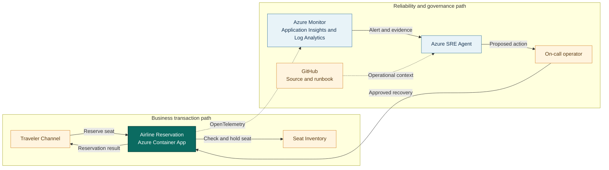

## Application overview

Airline Reservation creates synthetic flight reservations against seat inventory.
It represents a demand-facing transaction where failures block purchases and
can leave fare or capacity views inconsistent.

| Attribute | Value |
|-----------|-------|
| Portfolio | Customer experience |
| Business domain | Travel |
| Business operation | `reserve-seat` |
| Critical dependency | `seat-inventory` |
| Availability objective | 99.95 percent |
| Latency objective | Under 700 ms |
| Demonstrated fault | Application error |
| Business impact | Travelers cannot reserve seats and inventory becomes inconsistent |

The fault returns HTTP 500 while health probes can remain successful. No external
booking system or real traveler information is connected.

## System context diagrams

The transaction path captures the relationship between booking and seat capacity.
Azure SRE Agent investigates error and revision evidence without accessing
traveler information or changing inventory.

## Azure resources for telemetry and investigation

| Azure resource or configuration | Requirement | Purpose |
|---------------------------------|-------------|---------|
| Dedicated resource group | Required | Isolates cost, RBAC, policy, alerts, and investigation scope |
| Log Analytics workspace | Deployed | Stores Container Apps console and system logs for 30 days |
| Workspace-based Application Insights | Deployed | Receives OpenTelemetry requests, traces, and custom metrics |
| Container Apps environment | Deployed | Sends application and platform logs to Log Analytics |
| Airline Reservation Container App | Deployed | Provides revision, replica, ingress, probe, and scaling evidence |
| Azure Container Registry | Supporting | Stores the shared image used by the application revision |
| Workload managed identity | Supporting | Pulls the image with `AcrPull`; it has no booking access |
| Azure Monitor alert rules | Add | Detect reservation errors and SLO breaches |
| Application Insights availability test | Add | Tests `/health/ready` externally; not in the current Bicep |
| Azure SRE Agent and agent identity | Deploy separately | Investigates with approved read access in Review mode |
| Azure Monitor and GitHub connections | Configure separately | Supply incident, source, metadata, and runbook context |
| Activity Log diagnostic setting | Recommended | Retains deployment and control-plane events |
| Action group and Key Vault | Recommended | Notify humans and protect demonstration secrets |

### Required Airline Reservation signals

| Signal | Evidence to collect |
|--------|---------------------|
| Request telemetry | `POST /work`, status, duration, operation ID, and `service.name=airline-reservation` |
| Business metric | `showcase.business.operations` with outcome and fault mode |
| Application log | `synthetic_error` with `operation=reserve-seat` |
| Health | Liveness, readiness, and external availability |
| Platform | Revision, replica, ingress, scaling, deployment, CPU, and memory |
| Dependency | Add safe seat-inventory spans in production without traveler or fare data |

Traveler identifiers, itinerary details, payment data, and fare rules must not
appear in telemetry or SRE Agent context.

## Step-by-step telemetry configuration

1. Create a dedicated resource group with ownership, tags, budget, and policy.
2. Create Azure Container Registry and a workload identity with only `AcrPull`.
3. Deploy Log Analytics with approved retention and data access.
4. Create workspace-based Application Insights linked to the workspace.
5. Create the Container Apps environment and route platform and console logs.
6. Deploy Airline Reservation with `APP_SLUG=airline-reservation`, probes,
   Application Insights configuration, and the workload identity.
7. Verify sanitized request traces and business metrics use the Airline
   Reservation service name.
8. Route Activity Log events to Log Analytics for deployment correlation.
9. Alert on HTTP 500 or `synthetic_error`, scoped to `reserve-seat`, service,
   and revision.
10. Add a readiness availability test. In production, add safe seat-inventory
    availability and duration alerts.
11. Deploy Azure SRE Agent separately with approved read and query roles, then
    connect Azure Monitor, Application Insights, and GitHub.
12. Configure Review mode, generate baseline and error traffic, and verify the
    agent retrieves evidence, impact, and this runbook without traveler data.

## Where Azure SRE Agent plays a role

Azure SRE Agent correlates reservation errors with operation traces, active
revision, deployment history, and seat-inventory context.

1. Detect failed `reserve-seat` operations and quantify SLO impact.
2. Distinguish application error from dependency and readiness failure.
3. Compare errors across revisions and recent changes.
4. Explain traveler conversion and inventory-consistency impact.
5. Recommend fault clearing or a correlated rollback for approval.
6. Verify a new synthetic reservation after recovery.

The agent must not access passenger data, replay bookings, alter seat inventory,
change fares, or connect to a production reservation system.

## Detection and triage

Investigate HTTP 500 responses from `reserve-seat`. Escalate sustained failure or
evidence of a broader seat-inventory outage.

Collect the error trace, revision, deployment timeline, health status, and last
successful reservation.

## Investigation procedure

1. Confirm application metadata, SLO, and dependency.
2. Compare reservation failures with liveness and readiness.
3. Inspect error traces and seat-inventory context.
4. Correlate failure onset with revision or configuration changes.
5. Confirm only synthetic travelers and seats are used.
6. Present probable cause, confidence, blast radius, and response.

## Mitigation

Approve clearing the bounded error fault. Roll back only a revision correlated
with the incident. Production replay requires idempotency, payment, and inventory
reconciliation controls not represented here.

## Recovery verification

1. Confirm both health probes succeed.
2. Reserve three synthetic seats and confirm HTTP 200.
3. Verify latency remains under 700 ms and errors return to baseline.
4. Confirm the demonstration inventory remains internally consistent.
5. Record approval, action, evidence, and recovery time.

Escalate continued errors to the reservation application and inventory owners.
