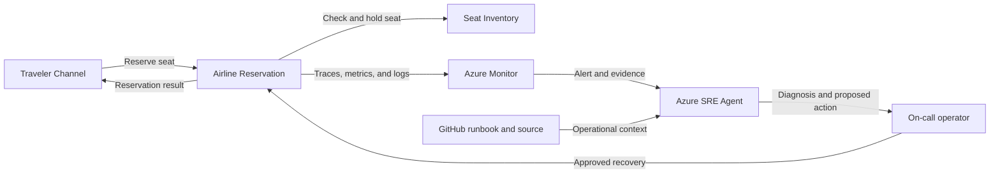

## Application overview

Airline Reservation creates synthetic flight reservations against seat inventory.
It represents a demand-facing transaction where failures block purchases and
can leave fare or capacity views inconsistent.

| Attribute | Value |
|-----------|-------|
| Portfolio | Customer experience |
| Business domain | Travel |
| Business operation | `reserve-seat` |
| Critical dependency | `seat-inventory` |
| Availability objective | 99.95 percent |
| Latency objective | Under 700 ms |
| Demonstrated fault | Application error |
| Business impact | Travelers cannot reserve seats and inventory becomes inconsistent |

The fault returns HTTP 500 while health probes can remain successful. No external
booking system or real traveler information is connected.

## Application architecture

The transaction path captures the relationship between booking and seat capacity.
Azure SRE Agent investigates error and revision evidence without accessing
traveler information or changing inventory.

## Where Azure SRE Agent plays a role

Azure SRE Agent correlates reservation errors with operation traces, active
revision, deployment history, and seat-inventory context.

1. Detect failed `reserve-seat` operations and quantify SLO impact.
2. Distinguish application error from dependency and readiness failure.
3. Compare errors across revisions and recent changes.
4. Explain traveler conversion and inventory-consistency impact.
5. Recommend fault clearing or a correlated rollback for approval.
6. Verify a new synthetic reservation after recovery.

The agent must not access passenger data, replay bookings, alter seat inventory,
change fares, or connect to a production reservation system.

## Detection and triage

Investigate HTTP 500 responses from `reserve-seat`. Escalate sustained failure or
evidence of a broader seat-inventory outage.

Collect the error trace, revision, deployment timeline, health status, and last
successful reservation.

## Investigation procedure

1. Confirm application metadata, SLO, and dependency.
2. Compare reservation failures with liveness and readiness.
3. Inspect error traces and seat-inventory context.
4. Correlate failure onset with revision or configuration changes.
5. Confirm only synthetic travelers and seats are used.
6. Present probable cause, confidence, blast radius, and response.

## Mitigation

Approve clearing the bounded error fault. Roll back only a revision correlated
with the incident. Production replay requires idempotency, payment, and inventory
reconciliation controls not represented here.

## Recovery verification

1. Confirm both health probes succeed.
2. Reserve three synthetic seats and confirm HTTP 200.
3. Verify latency remains under 700 ms and errors return to baseline.
4. Confirm the demonstration inventory remains internally consistent.
5. Record approval, action, evidence, and recovery time.

Escalate continued errors to the reservation application and inventory owners.
