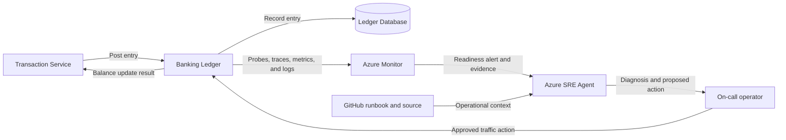

## Application overview

Banking Ledger records synthetic ledger entries with strict availability and
auditability expectations. It represents a regulated system of record where
unavailable write processing delays account balances and transaction settlement.

| Attribute | Value |
|-----------|-------|
| Portfolio | Financial services |
| Business domain | Banking |
| Business operation | `post-ledger-entry` |
| Critical dependency | `ledger-database` |
| Availability objective | 99.99 percent |
| Latency objective | Under 250 ms |
| Demonstrated fault | Revision not ready |
| Business impact | Balances stop updating and transaction processing is delayed |

The not-ready fault fails readiness while liveness remains successful. Azure
Container Apps should remove the unhealthy replica from traffic without treating
the process as crashed.

## Application architecture

The data path represents regulated ledger processing. The operations path limits
Azure SRE Agent to probe, revision, and telemetry evidence, with no access to
ledger records.

## Where Azure SRE Agent plays a role

Azure SRE Agent uses probe history, revision state, replica events, request
telemetry, and this runbook to distinguish readiness failure from ledger-data
failure.

1. Detect readiness failures while confirming process liveness.
2. Identify the affected revision and replica timeline.
3. Correlate readiness loss with deployment and platform events.
4. Explain the potential delay to balances and regulated processing.
5. Recommend the bounded fault clear or traffic removal for approval.
6. Verify readiness and a synthetic ledger operation after recovery.

The agent must not read or write ledger records, access database credentials,
change financial balances, broaden RBAC, or remove resources.

## Detection and triage

Investigate failed `/health/ready` probes while `/health/live` remains healthy.
Treat multiple unavailable replicas or sustained inability to post entries as a
high-priority transaction-processing incident.

Collect probe history, affected revision, replica events, deployment timestamp,
and failed synthetic-operation evidence.

## Investigation procedure

1. Confirm service identity, objectives, and dependency metadata.
2. Compare readiness and liveness histories.
3. Identify the unhealthy revision and any healthy traffic target.
4. Review revision rollout and Container Apps events near fault onset.
5. Confirm no ledger payload or real account data is in scope.
6. Present probable cause, confidence, blast radius, and proposed action.

## Mitigation

Approve clearing the bounded not-ready fault. If readiness does not recover,
remove the correlated revision from traffic through an approved action. Do not
grant database or transaction-write permissions to the agent.

Production database recovery follows the banking platform's audited continuity
procedure and requires the appropriate data owner.

## Recovery verification

1. Confirm `/health/live` and `/health/ready` return HTTP 200.
2. Submit one synthetic `post-ledger-entry` operation.
3. Confirm latency is under 250 ms and the operation succeeds.
4. Verify the recovered revision remains stable across subsequent probes.
5. Record the approver, action, evidence, and recovery time.

If readiness regresses, restore the last healthy traffic assignment and escalate
to the application and platform owners.
