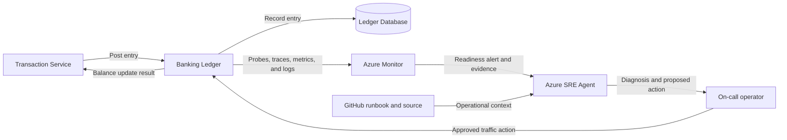

## Application overview

Banking Ledger records synthetic ledger entries with strict availability and
auditability expectations. It represents a regulated system of record where
unavailable write processing delays account balances and transaction settlement.

| Attribute | Value |
|-----------|-------|
| Portfolio | Financial services |
| Business domain | Banking |
| Business operation | `post-ledger-entry` |
| Critical dependency | `ledger-database` |
| Availability objective | 99.99 percent |
| Latency objective | Under 250 ms |
| Demonstrated fault | Revision not ready |
| Business impact | Balances stop updating and transaction processing is delayed |

The not-ready fault fails readiness while liveness remains successful. Azure
Container Apps should remove the unhealthy replica from traffic without treating
the process as crashed.

## Application architecture

The data path represents regulated ledger processing. The operations path limits
Azure SRE Agent to probe, revision, and telemetry evidence, with no access to
ledger records.

## Azure resources for telemetry and investigation

| Azure resource or configuration | Requirement | Purpose |
|---------------------------------|-------------|---------|
| Dedicated resource group | Required | Isolates cost, RBAC, policy, alerts, and investigation scope |
| Log Analytics workspace | Deployed | Stores Container Apps console and system logs for 30 days |
| Workspace-based Application Insights | Deployed | Receives OpenTelemetry requests, traces, and custom metrics |
| Container Apps environment | Deployed | Sends application and platform logs to Log Analytics |
| Banking Ledger Container App | Deployed | Provides revision, replica, ingress, probe, and scaling evidence |
| Azure Container Registry | Supporting | Stores the shared image used by the application revision |
| Workload managed identity | Supporting | Pulls the image with `AcrPull`; it has no ledger data access |
| Azure Monitor alert rules | Add | Detect readiness and SLO failures; not in the current Bicep |
| Application Insights availability test | Add | Tests `/health/ready` from outside the Container Apps environment |
| Azure SRE Agent and agent identity | Deploy separately | Investigates with Reader and monitoring access in Review mode |
| Azure Monitor and GitHub connections | Configure separately | Supply incident, source, metadata, and runbook context |
| Activity Log diagnostic setting | Recommended | Retains deployment and control-plane events in Log Analytics |
| Action group and Key Vault | Recommended | Notify humans and protect demonstration secrets |

### Required Banking Ledger signals

| Signal | Evidence to collect |
|--------|---------------------|
| Request telemetry | `POST /work`, status, duration, operation ID, and `service.name=banking-ledger` |
| Business metric | `showcase.business.operations` with outcome and fault-mode attributes |
| Readiness | `/health/ready` failures while `/health/live` remains successful |
| Platform | Revision, replica, ingress, probe, deployment, CPU, and memory evidence |
| Application log | Operation result without account, amount, balance, or transaction content |
| Dependency | Production database spans must be sanitized and must not include statements or records |

Ledger payloads, customer identifiers, balances, SQL statements, and credentials
must remain outside telemetry and agent context.

## Step-by-step telemetry configuration

1. Create a dedicated resource group with regulated-workload ownership, tags,
   budget, policy, and access review.
2. Create Azure Container Registry and a workload managed identity with only
   `AcrPull`; do not grant ledger permissions.
3. Deploy Log Analytics with approved retention and restricted query access.
4. Create workspace-based Application Insights linked to that workspace.
5. Create the Container Apps environment and route platform and console logs to
   Log Analytics.
6. Deploy Banking Ledger with `APP_SLUG=banking-ledger`, probes, Application
   Insights configuration, and the workload identity.
7. Confirm OpenTelemetry emits sanitized request traces and business metrics with
   the Banking Ledger service name.
8. Route Activity Log events to Log Analytics for revision and deployment evidence.
9. Create an alert when readiness fails while liveness succeeds, scoped by
   service name and revision.
10. Add an external `/health/ready` availability test and action group for
    regulated on-call notification.
11. Deploy Azure SRE Agent separately with approved read and monitoring-query
    roles only, then connect Azure Monitor, Application Insights, and GitHub.
12. Configure Review mode, generate baseline and not-ready signals, and verify
    the agent retrieves probes, revision events, metrics, impact, and this runbook
    without receiving ledger data.

## Where Azure SRE Agent plays a role

Azure SRE Agent uses probe history, revision state, replica events, request
telemetry, and this runbook to distinguish readiness failure from ledger-data
failure.

1. Detect readiness failures while confirming process liveness.
2. Identify the affected revision and replica timeline.
3. Correlate readiness loss with deployment and platform events.
4. Explain the potential delay to balances and regulated processing.
5. Recommend the bounded fault clear or traffic removal for approval.
6. Verify readiness and a synthetic ledger operation after recovery.

The agent must not read or write ledger records, access database credentials,
change financial balances, broaden RBAC, or remove resources.

## Detection and triage

Investigate failed `/health/ready` probes while `/health/live` remains healthy.
Treat multiple unavailable replicas or sustained inability to post entries as a
high-priority transaction-processing incident.

Collect probe history, affected revision, replica events, deployment timestamp,
and failed synthetic-operation evidence.

## Investigation procedure

1. Confirm service identity, objectives, and dependency metadata.
2. Compare readiness and liveness histories.
3. Identify the unhealthy revision and any healthy traffic target.
4. Review revision rollout and Container Apps events near fault onset.
5. Confirm no ledger payload or real account data is in scope.
6. Present probable cause, confidence, blast radius, and proposed action.

## Mitigation

Approve clearing the bounded not-ready fault. If readiness does not recover,
remove the correlated revision from traffic through an approved action. Do not
grant database or transaction-write permissions to the agent.

Production database recovery follows the banking platform's audited continuity
procedure and requires the appropriate data owner.

## Recovery verification

1. Confirm `/health/live` and `/health/ready` return HTTP 200.
2. Submit one synthetic `post-ledger-entry` operation.
3. Confirm latency is under 250 ms and the operation succeeds.
4. Verify the recovered revision remains stable across subsequent probes.
5. Record the approver, action, evidence, and recovery time.

If readiness regresses, restore the last healthy traffic assignment and escalate
to the application and platform owners.
