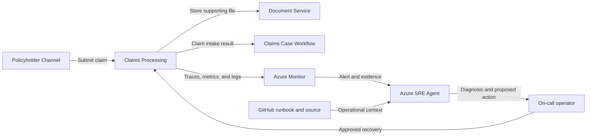

## Application overview

Claims Processing accepts synthetic insurance claims and coordinates supporting
documents. It represents a regulated intake workflow where dependency failure
stops new claims and increases the time policyholders wait for resolution.

| Attribute | Value |
|-----------|-------|
| Portfolio | Financial services |
| Business domain | Insurance |
| Business operation | `submit-claim` |
| Critical dependency | `document-service` |
| Availability objective | 99.9 percent |
| Latency objective | Under 1,000 ms |
| Demonstrated fault | Dependency unavailable |
| Business impact | Claim intake stops and policyholder resolution time increases |

The dependency fault returns HTTP 503 while application health can remain normal.
Only synthetic claims are permitted in the showcase.

## Application architecture

The claim path shows the document dependency without exposing document content.
Azure SRE Agent receives telemetry and runbook context, while regulated-data
access and recovery approval remain outside the agent.

## Azure resources for telemetry and investigation

| Azure resource or configuration | Requirement | Purpose |
|---------------------------------|-------------|---------|
| Dedicated resource group | Required | Isolates cost, RBAC, policy, alerts, and investigation scope |
| Log Analytics workspace | Deployed | Stores Container Apps console and system logs for 30 days |
| Workspace-based Application Insights | Deployed | Receives OpenTelemetry requests, traces, and custom metrics |
| Container Apps environment | Deployed | Sends application and platform logs to Log Analytics |
| Claims Processing Container App | Deployed | Provides revision, replica, ingress, probe, and scaling evidence |
| Azure Container Registry | Supporting | Stores the shared image used by the application revision |
| Workload managed identity | Supporting | Pulls the image with `AcrPull`; it has no document access |
| Azure Monitor alert rules | Add | Detect claim dependency errors and SLO breaches |
| Application Insights availability test | Add | Tests `/health/ready` externally; not in the current Bicep |
| Azure SRE Agent and agent identity | Deploy separately | Investigates with approved read access in Review mode |
| Azure Monitor and GitHub connections | Configure separately | Supply incident, source, metadata, and runbook context |
| Activity Log diagnostic setting | Recommended | Retains deployment and control-plane events |
| Action group and Key Vault | Recommended | Notify humans and protect demonstration secrets |

### Required Claims Processing signals

| Signal | Evidence to collect |
|--------|---------------------|
| Request telemetry | `POST /work`, status, duration, operation ID, and `service.name=claims-processing` |
| Business metric | `showcase.business.operations` with outcome and fault mode |
| Application log | `dependency_unavailable` with `dependency=document-service` |
| Health | Liveness, readiness, and external availability |
| Platform | Revision, replica, ingress, scaling, deployment, CPU, and memory |
| Dependency | Instrument document-client spans in production without names or content |

Claim documents, policyholder identifiers, policy numbers, and personal data must
never appear in telemetry, alerts, or SRE Agent context.

## Step-by-step telemetry configuration

1. Create a dedicated resource group with ownership, budget, policy, and access
   review for regulated telemetry.
2. Create Azure Container Registry and a workload identity with only `AcrPull`.
3. Deploy Log Analytics with approved retention and restricted query access.
4. Create workspace-based Application Insights linked to the workspace.
5. Create the Container Apps environment and route system and console logs.
6. Deploy Claims Processing with `APP_SLUG=claims-processing`, probes, the
   Application Insights connection string, and the workload identity.
7. Verify sanitized request traces and business metrics use the Claims Processing
   service name.
8. Route Activity Log events to Log Analytics for deployment correlation.
9. Alert on Claims Processing 503 responses or `dependency_unavailable`, scoped
   by service and revision.
10. Add a readiness availability test and an action group for human notification.
11. Deploy Azure SRE Agent separately with approved read and query roles, then
    connect Azure Monitor, Application Insights, and GitHub.
12. Configure Review mode, generate baseline and dependency-fault traffic, and
    verify the agent retrieves evidence and this runbook without document data.

## Where Azure SRE Agent plays a role

Azure SRE Agent correlates claim-submission failures with dependency traces,
revision state, resource health, and business metadata without reading claim
documents or policyholder data.

1. Detect failed `submit-claim` operations and SLO impact.
2. Correlate HTTP 503 responses with `document-service`.
3. Exclude readiness, deployment, and platform health causes.
4. Describe intake interruption and policyholder impact.
5. Recommend the bounded dependency-fault clear operation for approval.
6. Verify a new synthetic claim after recovery.

The agent must not retrieve documents, inspect personal data, replay claims,
change claim state, access secrets, or broaden permissions.

## Detection and triage

Investigate HTTP 503 responses referencing `document-service`. Escalate sustained
failure or any indication that a real document system is connected.

Collect the first failure, active revision, dependency span, health status, and
last successful synthetic claim.

## Investigation procedure

1. Confirm the SLO, operation, and dependency through `/api/metadata`.
2. Compare claim failures with liveness and readiness.
3. Inspect dependency spans without opening payloads.
4. Review revisions and Azure resource health near fault onset.
5. Confirm all data and connected systems are synthetic.
6. State probable cause, confidence, impact, and proposed reversible action.

## Mitigation

Approve clearing the bounded dependency fault. Production document replay
requires a separate data-handling, retention, and idempotency procedure.

Stop the exercise immediately if regulated data or a production connector is
detected.

## Recovery verification

1. Confirm readiness returns HTTP 200.
2. Submit one synthetic claim and confirm HTTP 200.
3. Verify latency remains under 1,000 ms and dependency errors stop.
4. Confirm no unauthorized data was accessed during the investigation.
5. Record approval, action, recovery time, and follow-up.

Escalate unresolved dependency failure to the document-service owner.
