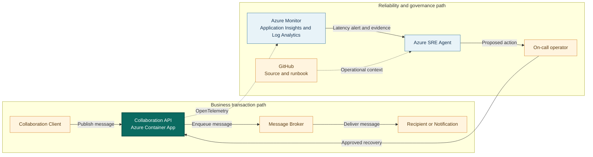

## Application overview

Collaboration API publishes synthetic messages and notifications for enterprise
teams. It represents a shared productivity service where delays interrupt
time-sensitive communication even if publishing eventually succeeds.

| Attribute | Value |
|-----------|-------|
| Portfolio | Digital platforms |
| Business domain | Productivity |
| Business operation | `publish-message` |
| Critical dependency | `message-broker` |
| Availability objective | 99.95 percent |
| Latency objective | Under 300 ms |
| Demonstrated fault | Elevated latency |
| Business impact | Teams cannot exchange time-sensitive messages or notifications |

The latency fault keeps status codes and probes successful. Request and dependency
duration provide the primary incident evidence.

## System context diagrams

The messaging path shows where broker delay affects collaboration. Azure SRE
Agent uses duration and capacity evidence without reading message bodies or
purging queued content.

## Azure resources for telemetry and investigation

| Azure resource or configuration | Requirement | Purpose |
|---------------------------------|-------------|---------|
| Dedicated resource group | Required | Isolates cost, RBAC, policy, alerts, and investigation scope |
| Log Analytics workspace | Deployed | Stores Container Apps console and system logs for 30 days |
| Workspace-based Application Insights | Deployed | Receives OpenTelemetry requests, traces, and custom metrics |
| Container Apps environment | Deployed | Sends application and platform logs to Log Analytics |
| Collaboration API Container App | Deployed | Provides revision, replica, ingress, probe, and scaling evidence |
| Azure Container Registry | Supporting | Stores the shared image used by the application revision |
| Workload managed identity | Supporting | Pulls the image with `AcrPull` |
| Azure Monitor alert rules | Add | Detect publishing latency and errors; not in current Bicep |
| Application Insights availability test | Add | Tests `/health/ready` externally |
| Azure SRE Agent and agent identity | Deploy separately | Investigates with approved read access in Review mode |
| Azure Monitor and GitHub connections | Configure separately | Supply incident, source, metadata, and runbook context |
| Activity Log diagnostic setting | Recommended | Retains deployment and control-plane events |
| Action group and Key Vault | Recommended | Notify humans and protect demonstration secrets |

### Required Collaboration API signals

| Signal | Evidence to collect |
|--------|---------------------|
| Request telemetry | `POST /work`, duration, status, operation ID, and `service.name=collaboration-api` |
| Business metric | `showcase.business.operations` with outcome and fault mode |
| Latency | Request percentiles compared with the 300 ms objective |
| Health | Liveness, readiness, and external availability |
| Platform | Revision, replica, ingress, scaling, deployment, CPU, and memory |
| Dependency | Add broker-client spans, publish failures, backlog, and oldest-message metrics in production |

Message bodies, participant identities, channel names, attachments, and broker
credentials must remain outside telemetry and SRE Agent context.

## Step-by-step telemetry configuration

1. Create a dedicated resource group with ownership, tags, budget, and policy.
2. Create Azure Container Registry and a workload identity with only `AcrPull`.
3. Deploy Log Analytics with approved retention and data access.
4. Create workspace-based Application Insights linked to the workspace.
5. Create the Container Apps environment and route platform and console logs.
6. Deploy Collaboration API with `APP_SLUG=collaboration-api`, probes,
   Application Insights configuration, and the workload identity.
7. Verify sanitized request traces and business metrics use the Collaboration
   API service name.
8. Route Activity Log events to Log Analytics for deployment correlation.
9. Alert on sustained publish duration above 300 ms and on request errors,
   scoped by service and revision.
10. Add a readiness availability test. In production, alert on broker publish
    failures, backlog, consumer lag, and oldest-message age.
11. Deploy Azure SRE Agent separately with approved read and query roles, then
    connect Azure Monitor, Application Insights, and GitHub.
12. Configure Review mode, generate baseline and latency traffic, and verify the
    agent retrieves operational evidence without message content.

## Where Azure SRE Agent plays a role

Azure SRE Agent correlates publishing duration with broker spans, revision state,
and platform capacity without reading message content.

1. Detect publish latency above 300 ms.
2. Compare end-to-end time with `message-broker` duration.
3. Exclude revision, readiness, scaling, and compute causes.
4. Explain delayed communication and notification impact.
5. Recommend the bounded latency-fault clear operation for approval.
6. Verify sustained recovery with synthetic messages.

The agent must not read message bodies, inspect customer or employee content,
access broker credentials, purge queues, or change capacity without approval.

## Detection and triage

Investigate latency above the objective with successful responses and probes.
Escalate when the condition is sustained or notification delivery is affected.

Collect percentile duration, dependency spans, revision, utilization, and first
SLO violation.

## Investigation procedure

1. Confirm service metadata and the 300 ms objective.
2. Compare request duration with broker span duration.
3. Review latency by revision and deployment time.
4. Exclude replica scaling and resource saturation.
5. Verify telemetry contains no message content.
6. Present probable cause, confidence, impact, and response.

## Mitigation

Approve clearing the bounded latency fault. Production queue scaling or routing
requires separate capacity, cost, and change approval.

## Recovery verification

1. Publish three synthetic messages.
2. Confirm each succeeds below 300 ms.
3. Verify probes remain healthy and latency returns to baseline.
4. Confirm no new publishing errors appear.
5. Record approval, action, evidence, and recovery time.

Reverse any capacity or configuration change that increases errors or cost risk.
