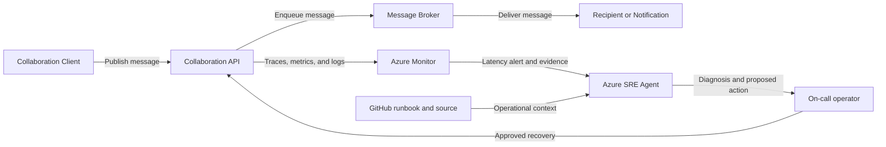

## Application overview

Collaboration API publishes synthetic messages and notifications for enterprise
teams. It represents a shared productivity service where delays interrupt
time-sensitive communication even if publishing eventually succeeds.

| Attribute | Value |
|-----------|-------|
| Portfolio | Digital platforms |
| Business domain | Productivity |
| Business operation | `publish-message` |
| Critical dependency | `message-broker` |
| Availability objective | 99.95 percent |
| Latency objective | Under 300 ms |
| Demonstrated fault | Elevated latency |
| Business impact | Teams cannot exchange time-sensitive messages or notifications |

The latency fault keeps status codes and probes successful. Request and dependency
duration provide the primary incident evidence.

## Application architecture

The messaging path shows where broker delay affects collaboration. Azure SRE
Agent uses duration and capacity evidence without reading message bodies or
purging queued content.

## Where Azure SRE Agent plays a role

Azure SRE Agent correlates publishing duration with broker spans, revision state,
and platform capacity without reading message content.

1. Detect publish latency above 300 ms.
2. Compare end-to-end time with `message-broker` duration.
3. Exclude revision, readiness, scaling, and compute causes.
4. Explain delayed communication and notification impact.
5. Recommend the bounded latency-fault clear operation for approval.
6. Verify sustained recovery with synthetic messages.

The agent must not read message bodies, inspect customer or employee content,
access broker credentials, purge queues, or change capacity without approval.

## Detection and triage

Investigate latency above the objective with successful responses and probes.
Escalate when the condition is sustained or notification delivery is affected.

Collect percentile duration, dependency spans, revision, utilization, and first
SLO violation.

## Investigation procedure

1. Confirm service metadata and the 300 ms objective.
2. Compare request duration with broker span duration.
3. Review latency by revision and deployment time.
4. Exclude replica scaling and resource saturation.
5. Verify telemetry contains no message content.
6. Present probable cause, confidence, impact, and response.

## Mitigation

Approve clearing the bounded latency fault. Production queue scaling or routing
requires separate capacity, cost, and change approval.

## Recovery verification

1. Publish three synthetic messages.
2. Confirm each succeeds below 300 ms.
3. Verify probes remain healthy and latency returns to baseline.
4. Confirm no new publishing errors appear.
5. Record approval, action, evidence, and recovery time.

Reverse any capacity or configuration change that increases errors or cost risk.
