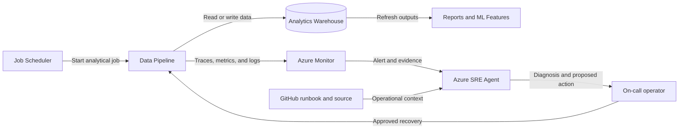

## Application overview

Data Pipeline starts synthetic analytical processing jobs against a downstream
warehouse. It represents the path that refreshes executive reporting and machine
learning features. A warehouse outage creates stale business information.

| Attribute | Value |
|-----------|-------|
| Portfolio | Industrial and data |
| Business domain | Analytics |
| Business operation | `start-data-job` |
| Critical dependency | `analytics-warehouse` |
| Availability objective | 99.5 percent |
| Latency objective | Under 1,500 ms |
| Demonstrated fault | Dependency unavailable |
| Business impact | Reports and machine-learning features become stale |

The dependency fault returns HTTP 503 while application probes can remain healthy.
Only synthetic jobs and a simulated dependency are in scope.

## Application architecture

The data path connects scheduled processing to downstream freshness. Azure SRE
Agent investigates warehouse dependency evidence without querying data or
modifying production jobs.

## Where Azure SRE Agent plays a role

Azure SRE Agent correlates job-start failures with warehouse spans, resource
health, revision state, and data-freshness impact.

1. Detect failed `start-data-job` operations.
2. Correlate HTTP 503 responses with `analytics-warehouse`.
3. Exclude process, readiness, revision, and platform causes.
4. Explain downstream reporting and feature-freshness impact.
5. Recommend the bounded dependency-fault clear operation for approval.
6. Verify a new synthetic job and telemetry recovery.

The agent must not start, cancel, retry, or modify real jobs. It must not query
warehouse data, access credentials, or change production schedules.

## Detection and triage

Investigate HTTP 503 responses referencing the warehouse. Escalate when freshness
objectives are at risk or downstream consumers report stale results.

Collect dependency spans, active revision, resource health, first failure, and
last successful synthetic job.

## Investigation procedure

1. Confirm service metadata and the 1,500 ms objective.
2. Compare job failures with liveness and readiness.
3. Inspect warehouse dependency evidence.
4. Review revisions and Azure resource events near fault onset.
5. Confirm only synthetic jobs are connected.
6. Present probable cause, confidence, impact, and reversible action.

## Mitigation

Approve clearing the bounded dependency fault. Do not retry, cancel, or modify
real analytical jobs. Stop the exercise if a production warehouse connector is
present.

## Recovery verification

1. Confirm readiness returns HTTP 200.
2. Start one synthetic data job and confirm HTTP 200.
3. Verify latency remains under 1,500 ms and dependency errors stop.
4. Confirm synthetic freshness telemetry begins recovering.
5. Record approval, action, evidence, and follow-up.

Production backfill requires data-owner approval and duplicate-processing controls.
