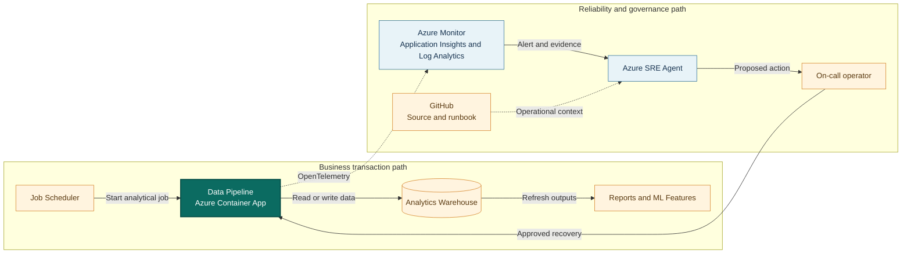

## Application overview

Data Pipeline starts synthetic analytical processing jobs against a downstream
warehouse. It represents the path that refreshes executive reporting and machine
learning features. A warehouse outage creates stale business information.

| Attribute | Value |
|-----------|-------|
| Portfolio | Industrial and data |
| Business domain | Analytics |
| Business operation | `start-data-job` |
| Critical dependency | `analytics-warehouse` |
| Availability objective | 99.5 percent |
| Latency objective | Under 1,500 ms |
| Demonstrated fault | Dependency unavailable |
| Business impact | Reports and machine-learning features become stale |

The dependency fault returns HTTP 503 while application probes can remain healthy.
Only synthetic jobs and a simulated dependency are in scope.

## System context diagrams

The data path connects scheduled processing to downstream freshness. Azure SRE
Agent investigates warehouse dependency evidence without querying data or
modifying production jobs.

## Azure resources for telemetry and investigation

| Azure resource or configuration | Requirement | Purpose |
|---------------------------------|-------------|---------|
| Dedicated resource group | Required | Isolates cost, RBAC, policy, alerts, and investigation scope |
| Log Analytics workspace | Deployed | Stores Container Apps console and system logs for 30 days |
| Workspace-based Application Insights | Deployed | Receives OpenTelemetry requests, traces, and custom metrics |
| Container Apps environment | Deployed | Sends application and platform logs to Log Analytics |
| Data Pipeline Container App | Deployed | Provides revision, replica, ingress, probe, and scaling evidence |
| Azure Container Registry | Supporting | Stores the shared image used by the application revision |
| Workload managed identity | Supporting | Pulls the image with `AcrPull`; it has no warehouse access |
| Azure Monitor alert rules | Add | Detect job errors and stale output; not in current Bicep |
| Application Insights availability test | Add | Tests `/health/ready` externally |
| Azure SRE Agent and agent identity | Deploy separately | Investigates with approved read access in Review mode |
| Azure Monitor and GitHub connections | Configure separately | Supply incident, source, metadata, and runbook context |
| Activity Log diagnostic setting | Recommended | Retains deployment and control-plane events |
| Action group and Key Vault | Recommended | Notify humans and protect demonstration secrets |

### Required Data Pipeline signals

| Signal | Evidence to collect |
|--------|---------------------|
| Request telemetry | `POST /work`, status, duration, operation ID, and `service.name=data-pipeline` |
| Business metric | `showcase.business.operations` with outcome and fault mode |
| Application log | `dependency_unavailable` with `dependency=analytics-warehouse` |
| Health | Liveness, readiness, and external availability |
| Platform | Revision, replica, ingress, scaling, deployment, CPU, and memory |
| Dependency | Add warehouse-client spans, job status, queue delay, and freshness metrics in production |

Query text, source records, report content, credentials, and production job
parameters must remain outside telemetry and agent context.

## Step-by-step telemetry configuration

1. Create a dedicated resource group with ownership, tags, budget, and policy.
2. Create Azure Container Registry and a workload identity with only `AcrPull`.
3. Deploy Log Analytics with approved retention and data access.
4. Create workspace-based Application Insights linked to the workspace.
5. Create the Container Apps environment and route platform and console logs.
6. Deploy Data Pipeline with `APP_SLUG=data-pipeline`, probes, Application
   Insights configuration, and the workload identity.
7. Verify sanitized request traces and business metrics use the Data Pipeline
   service name.
8. Route Activity Log events to Log Analytics for deployment correlation.
9. Alert on 503 responses or `dependency_unavailable`, scoped by service,
   revision, and warehouse dependency.
10. Add a readiness availability test. In production, alert on job failure,
    queue delay, completion duration, and data-freshness objectives.
11. Deploy Azure SRE Agent separately with approved read and query roles, then
    connect Azure Monitor, Application Insights, and GitHub.
12. Configure Review mode, generate baseline and dependency-fault traffic, and
    verify the agent retrieves evidence and this runbook without warehouse data.

## Where Azure SRE Agent plays a role

Azure SRE Agent correlates job-start failures with warehouse spans, resource
health, revision state, and data-freshness impact.

1. Detect failed `start-data-job` operations.
2. Correlate HTTP 503 responses with `analytics-warehouse`.
3. Exclude process, readiness, revision, and platform causes.
4. Explain downstream reporting and feature-freshness impact.
5. Recommend the bounded dependency-fault clear operation for approval.
6. Verify a new synthetic job and telemetry recovery.

The agent must not start, cancel, retry, or modify real jobs. It must not query
warehouse data, access credentials, or change production schedules.

## Detection and triage

Investigate HTTP 503 responses referencing the warehouse. Escalate when freshness
objectives are at risk or downstream consumers report stale results.

Collect dependency spans, active revision, resource health, first failure, and
last successful synthetic job.

## Investigation procedure

1. Confirm service metadata and the 1,500 ms objective.
2. Compare job failures with liveness and readiness.
3. Inspect warehouse dependency evidence.
4. Review revisions and Azure resource events near fault onset.
5. Confirm only synthetic jobs are connected.
6. Present probable cause, confidence, impact, and reversible action.

## Mitigation

Approve clearing the bounded dependency fault. Do not retry, cancel, or modify
real analytical jobs. Stop the exercise if a production warehouse connector is
present.

## Recovery verification

1. Confirm readiness returns HTTP 200.
2. Start one synthetic data job and confirm HTTP 200.
3. Verify latency remains under 1,500 ms and dependency errors stop.
4. Confirm synthetic freshness telemetry begins recovering.
5. Record approval, action, evidence, and follow-up.

Production backfill requires data-owner approval and duplicate-processing controls.
