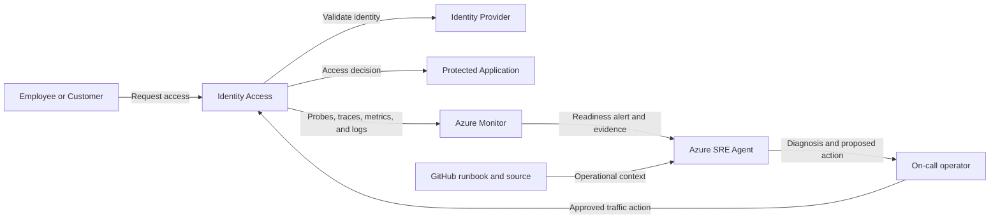

## Application overview

Identity Access evaluates synthetic access requests and represents a shared
security service with a broad enterprise blast radius. Readiness loss prevents
employees and customers from reaching protected systems.

| Attribute | Value |
|-----------|-------|
| Portfolio | Digital platforms |
| Business domain | Enterprise security |
| Business operation | `evaluate-access` |
| Critical dependency | `identity-provider` |
| Availability objective | 99.99 percent |
| Latency objective | Under 200 ms |
| Demonstrated fault | Revision not ready |
| Business impact | Users cannot access protected enterprise systems |

The not-ready fault fails readiness while process liveness remains successful.
The showcase evaluates synthetic identities and does not issue real tokens.

## Application architecture

The access path has a broad application blast radius. Azure SRE Agent uses probe
and revision evidence without reading identities, tokens, group membership, or
access policy.

## Azure resources for telemetry and investigation

| Azure resource or configuration | Requirement | Purpose |
|---------------------------------|-------------|---------|
| Dedicated resource group | Required | Isolates cost, RBAC, policy, alerts, and investigation scope |
| Log Analytics workspace | Deployed | Stores Container Apps console and system logs for 30 days |
| Workspace-based Application Insights | Deployed | Receives OpenTelemetry requests, traces, and custom metrics |
| Container Apps environment | Deployed | Sends application and platform logs to Log Analytics |
| Identity Access Container App | Deployed | Provides revision, replica, ingress, probe, and scaling evidence |
| Azure Container Registry | Supporting | Stores the shared image used by the application revision |
| Workload managed identity | Supporting | Pulls the image with `AcrPull`; it has no directory access |
| Azure Monitor alert rules | Add | Detect readiness and access-evaluation failures |
| Application Insights availability test | Add | Tests `/health/ready` externally; not in current Bicep |
| Azure SRE Agent and agent identity | Deploy separately | Investigates with approved read access in Review mode |
| Azure Monitor and GitHub connections | Configure separately | Supply incident, source, metadata, and runbook context |
| Activity Log diagnostic setting | Recommended | Retains deployment and control-plane events |
| Action group and Key Vault | Recommended | Notify humans and protect demonstration secrets |

### Required Identity Access signals

| Signal | Evidence to collect |
|--------|---------------------|
| Request telemetry | `POST /work`, status, duration, operation ID, and `service.name=identity-access` |
| Business metric | `showcase.business.operations` with outcome and fault mode |
| Readiness | `/health/ready` failures while `/health/live` remains successful |
| Platform | Revision, replica, ingress, probe, deployment, CPU, and memory |
| Application log | Access-evaluation outcome without identity or policy content |
| Dependency | Add sanitized identity-provider spans and availability metrics in production |

Tokens, claims, user identifiers, group membership, credentials, and policy
details must remain outside telemetry and SRE Agent context.

## Step-by-step telemetry configuration

1. Create a dedicated resource group with security ownership, policy, budget,
   and access review.
2. Create Azure Container Registry and a workload identity with only `AcrPull`;
   do not grant directory roles.
3. Deploy Log Analytics with restricted query access and approved retention.
4. Create workspace-based Application Insights linked to the workspace.
5. Create the Container Apps environment and route platform and console logs.
6. Deploy Identity Access with `APP_SLUG=identity-access`, probes, Application
   Insights configuration, and the workload identity.
7. Verify sanitized request traces and business metrics use the Identity Access
   service name.
8. Route Activity Log events to Log Analytics for deployment correlation.
9. Alert when readiness fails while liveness succeeds, scoped by service and
   revision, plus an access-evaluation error alert.
10. Add an external readiness availability test and security on-call action group.
11. Deploy Azure SRE Agent separately with approved read and query roles only,
    then connect Azure Monitor, Application Insights, and GitHub.
12. Configure Review mode, generate baseline and not-ready signals, and verify
    evidence retrieval without identities, tokens, or directory data.

## Where Azure SRE Agent plays a role

Azure SRE Agent correlates probe history, revision health, deployment events, and
identity-provider context without accessing identity data.

1. Detect readiness failure while confirming liveness.
2. Identify the affected revision and traffic impact.
3. Correlate failure with rollout and platform events.
4. Explain broad access-continuity impact.
5. Recommend fault clearing or removal of an unhealthy revision for approval.
6. Verify readiness and a synthetic access evaluation.

The agent must not read tokens, secrets, identities, group membership, or access
policies. It must not grant roles or change authentication configuration.

## Detection and triage

Investigate failed readiness with successful liveness. Treat loss across multiple
replicas as high priority because the service has a broad dependent population.

Collect probe history, revision, replica events, deployment time, and failed
synthetic evaluation evidence.

## Investigation procedure

1. Confirm service identity and the 200 ms objective.
2. Compare readiness and liveness histories.
3. Identify unhealthy and healthy revisions.
4. Review deployment and Container Apps events at fault onset.
5. Confirm the agent's data and tool restrictions remain enforced.
6. Present probable cause, confidence, blast radius, and proposed action.

## Mitigation

Approve clearing the bounded not-ready fault. If readiness does not recover,
remove the correlated revision from traffic through an approved action.
Production failover must follow the organization's access-control emergency plan.

## Recovery verification

1. Confirm both health probes return HTTP 200.
2. Submit one synthetic access evaluation.
3. Confirm success below 200 ms.
4. Verify the recovered revision remains stable.
5. Revoke any temporary authorization and record all actions.

Escalate immediately if recovery would require broader identity privileges.
