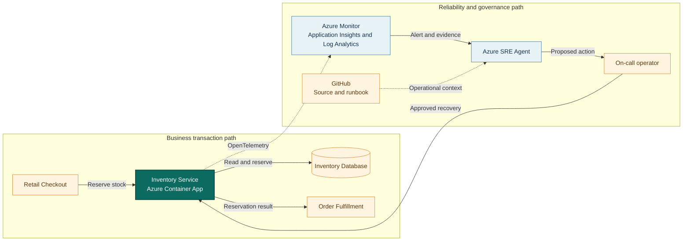

## Application overview

Inventory Service reserves stock before an order is accepted. Retail Checkout
uses the reservation result to prevent overselling, while Order Fulfillment
depends on accurate inventory state before dispatch. The showcase performs only
synthetic reservations and never changes real stock.

| Attribute | Value |
|-----------|-------|
| Portfolio | Commerce and retail |
| Business domain | Retail |
| Business operation | `reserve-inventory` |
| Critical dependency | `inventory-database` |
| Availability objective | 99.9 percent |
| Latency objective | Under 500 ms |
| Demonstrated fault | Dependency unavailable |
| Business impact | Orders oversell or fail because inventory cannot be reserved |

The process can remain live and ready while the database dependency returns an
error. This distinction helps operators avoid restarting a healthy application
when the actual failure is downstream.

## System context diagrams

The diagram separates the customer order path from the observability and
governance path. Azure SRE Agent investigates through telemetry and repository
context, while the operator retains approval authority for recovery.

## Azure resources for telemetry and investigation

| Azure resource or configuration | Requirement | Purpose |
|---------------------------------|-------------|---------|
| Dedicated resource group | Required | Isolates cost, RBAC, policy, alerts, and investigation scope |
| Log Analytics workspace | Deployed | Stores Container Apps console and system logs for 30 days |
| Workspace-based Application Insights | Deployed | Receives OpenTelemetry requests, traces, and custom metrics |
| Container Apps environment | Deployed | Sends application and platform logs to Log Analytics |
| Inventory Service Container App | Deployed | Provides revision, replica, ingress, probe, and scaling evidence |
| Azure Container Registry | Supporting | Stores the shared image used by the application revision |
| Workload managed identity | Supporting | Pulls the image with `AcrPull`; it is not the SRE Agent identity |
| Azure Monitor alert rules | Add | Detect dependency errors and SLO breaches; not in the current Bicep |
| Application Insights availability test | Add | Tests `/health/ready` from outside the Container Apps environment |
| Azure SRE Agent and agent identity | Deploy separately | Investigates with Reader and monitoring access in Review mode |
| Azure Monitor and GitHub connections | Configure separately | Supply incident, source, metadata, and runbook context |
| Activity Log diagnostic setting | Recommended | Retains deployment and control-plane events in Log Analytics |
| Action group and Key Vault | Recommended | Notify humans and protect demonstration secrets |

### Required Inventory Service signals

| Signal | Evidence to collect |
|--------|---------------------|
| Request telemetry | `POST /work`, status, duration, operation ID, and `service.name=inventory-service` |
| Business metric | `showcase.business.operations` with outcome and fault-mode attributes |
| Application log | `dependency_unavailable` with `dependency=inventory-database` |
| Health | `/health/live` and `/health/ready` status and external availability |
| Platform | Revision, replica, ingress, scaling, deployment, CPU, and memory evidence |
| Dependency | The showcase logs the simulated dependency name; production must instrument database-client spans |

Do not interpret the synthetic dependency log as a real database call. In a
production implementation, add OpenTelemetry database-client instrumentation and
sanitize statements, connection details, and customer identifiers.

## Step-by-step telemetry configuration

1. Create a dedicated resource group and assign owners, tags, budget, and policy.
2. Create Azure Container Registry and a workload managed identity with only
   `AcrPull` on that registry.
3. Deploy Log Analytics with the approved retention and data-access controls.
4. Create workspace-based Application Insights linked to that workspace.
5. Create the Container Apps environment and route console and system logs to
   Log Analytics.
6. Deploy Inventory Service with `APP_SLUG=inventory-service`, health probes,
   the Application Insights connection string, and the workload identity.
7. Confirm the Azure Monitor OpenTelemetry distribution exports FastAPI request
   traces and `showcase.business.operations` with the Inventory Service name.
8. Add an Activity Log diagnostic setting when deployment history must be queried
   with application telemetry.
9. Create an alert for Inventory Service 503 failures or
   `dependency_unavailable`, scoped by service name and revision.
10. Add an availability test for `/health/ready` and an alert for consecutive
    failures. Use an action group when human notification is required.
11. Deploy Azure SRE Agent separately, grant its identity Reader and approved
    monitoring-query roles on this resource group, and connect Azure Monitor,
    Application Insights, and this GitHub repository.
12. Configure a Review-mode response plan, generate baseline and fault traffic,
    then confirm the agent can retrieve the alert, trace, log, metric, revision,
    business impact, and this runbook before approving any action.

## Where Azure SRE Agent plays a role

Azure SRE Agent connects the Azure Monitor alert to application telemetry,
Container Apps revision state, this runbook, and the service metadata. Its role
is to shorten investigation time while preserving operator accountability.

1. Detect HTTP 503 growth and identify Inventory Service as the affected workload.
2. Correlate failed `reserve-inventory` traces with `inventory-database`.
3. Compare liveness, readiness, revision, and resource health to exclude a process
   or deployment failure.
4. Identify correlated checkout and fulfillment impact and explain the risk of
   overselling or rejected orders.
5. Recommend the bounded fault-clear operation in Review mode.
6. After approval, verify readiness and a successful synthetic reservation.

The agent must not inspect customer orders, alter quantities, write to an
inventory database, broaden RBAC, retrieve secrets, or delete resources.

## Detection and triage

Investigate when HTTP 503 responses rise or the business-operation counter records
failed reservations. Confirm `/health/live` and `/health/ready` before assigning
severity. Treat correlated checkout failures as revenue-path impact.

Collect the alert time, affected revision, status-code trend, failed trace,
dependency name, and the first observed business failure.

## Investigation procedure

1. Read `/api/metadata` and confirm the expected SLO and dependency.
2. Compare request failures with successful liveness and readiness probes.
3. Inspect failed spans for the `inventory-database` dependency marker.
4. Check revision changes and Azure resource health near the first failure.
5. Look for correlated impact in Retail Checkout and Order Fulfillment.
6. State the probable cause, evidence, confidence, blast radius, and proposed
   reversible action before requesting approval.

## Mitigation

In the showcase, approve clearing the bounded dependency fault. Do not simulate
inventory writes or adjust quantities. In production, use the inventory team's
approved database failover, circuit-breaker, or traffic-control procedure.

If the dependency remains unavailable, stop checkout traffic that requires a
confirmed reservation and escalate to the inventory database owner.

## Recovery verification

1. Confirm `/health/ready` returns HTTP 200.
2. Submit one synthetic `reserve-inventory` operation and confirm HTTP 200.
3. Confirm dependency errors stop and request latency remains under 500 ms.
4. Verify correlated checkout and fulfillment failures recover.
5. Record the approver, action, recovery time, and remaining follow-up.

Rollback any application or routing change that introduces new errors. Do not
close the incident based only on a healthy process probe.
