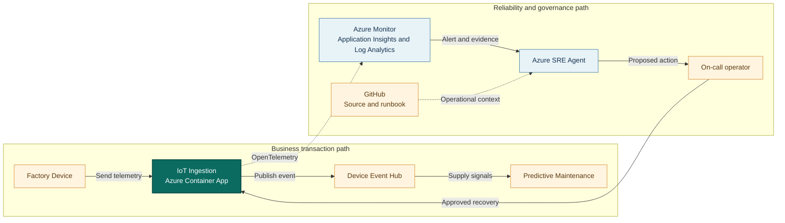

## Application overview

IoT Ingestion accepts synthetic device telemetry and represents the entry point
for manufacturing monitoring and predictive-maintenance signals. Failed ingestion
creates data gaps and delays detection of equipment risk.

| Attribute | Value |
|-----------|-------|
| Portfolio | Industrial and data |
| Business domain | Manufacturing |
| Business operation | `ingest-telemetry` |
| Critical dependency | `device-event-hub` |
| Availability objective | 99.9 percent |
| Latency objective | Under 400 ms |
| Demonstrated fault | Application error |
| Business impact | Factory telemetry is lost and maintenance signals arrive late |

The fault returns HTTP 500 from ingestion while health probes may remain normal.
The showcase uses synthetic devices and contains no factory data.

## System context diagrams

The ingestion path supplies downstream maintenance signals. Azure SRE Agent
correlates application, revision, and stream evidence without accessing real
factory payloads or changing event partitions.

## Azure resources for telemetry and investigation

| Azure resource or configuration | Requirement | Purpose |
|---------------------------------|-------------|---------|
| Dedicated resource group | Required | Isolates cost, RBAC, policy, alerts, and investigation scope |
| Log Analytics workspace | Deployed | Stores Container Apps console and system logs for 30 days |
| Workspace-based Application Insights | Deployed | Receives OpenTelemetry requests, traces, and custom metrics |
| Container Apps environment | Deployed | Sends application and platform logs to Log Analytics |
| IoT Ingestion Container App | Deployed | Provides revision, replica, ingress, probe, and scaling evidence |
| Azure Container Registry | Supporting | Stores the shared image used by the application revision |
| Workload managed identity | Supporting | Pulls the image with `AcrPull` |
| Azure Monitor alert rules | Add | Detect ingestion errors and signal gaps; not in current Bicep |
| Application Insights availability test | Add | Tests `/health/ready` externally |
| Azure SRE Agent and agent identity | Deploy separately | Investigates with approved read access in Review mode |
| Azure Monitor and GitHub connections | Configure separately | Supply incident, source, metadata, and runbook context |
| Activity Log diagnostic setting | Recommended | Retains deployment and control-plane events |
| Action group and Key Vault | Recommended | Notify humans and protect demonstration secrets |

### Required IoT Ingestion signals

| Signal | Evidence to collect |
|--------|---------------------|
| Request telemetry | `POST /work`, status, duration, operation ID, and `service.name=iot-ingestion` |
| Business metric | `showcase.business.operations` with outcome and fault mode |
| Application log | `synthetic_error` with `operation=ingest-telemetry` |
| Health | Liveness, readiness, and external availability |
| Platform | Revision, replica, ingress, scaling, deployment, CPU, and memory |
| Dependency | Add Event Hubs client spans, throttling, incoming-message, and backlog metrics in production |

Device identifiers, production payloads, plant topology, and equipment readings
must not enter showcase telemetry or SRE Agent context.

## Step-by-step telemetry configuration

1. Create a dedicated resource group with ownership, tags, budget, and policy.
2. Create Azure Container Registry and a workload identity with only `AcrPull`.
3. Deploy Log Analytics with approved retention and data access.
4. Create workspace-based Application Insights linked to the workspace.
5. Create the Container Apps environment and route platform and console logs.
6. Deploy IoT Ingestion with `APP_SLUG=iot-ingestion`, probes, Application
   Insights configuration, and the workload identity.
7. Verify sanitized request traces and business metrics use the IoT Ingestion
   service name.
8. Route Activity Log events to Log Analytics for deployment correlation.
9. Alert on HTTP 500 or `synthetic_error`, scoped to `ingest-telemetry`,
   service, and revision.
10. Add a readiness availability test. In production, alert on Event Hubs
    throttling, incoming-message decline, backlog, and consumer lag.
11. Deploy Azure SRE Agent separately with approved read and query roles, then
    connect Azure Monitor, Application Insights, and GitHub.
12. Configure Review mode, generate baseline and error traffic, and verify the
    agent retrieves operational evidence without factory data.

## Where Azure SRE Agent plays a role

Azure SRE Agent correlates ingestion errors with operation traces, revision
history, event-hub context, and business impact.

1. Detect failed `ingest-telemetry` operations.
2. Distinguish application error from stream and readiness failure.
3. Compare errors by revision and deployment time.
4. Explain telemetry-loss and maintenance-signal impact.
5. Recommend fault clearing or a correlated rollback for approval.
6. Verify successful synthetic ingestion after recovery.

The agent must not inspect real device payloads, replay events, change partitions,
access event-hub secrets, or connect to production equipment.

## Detection and triage

Investigate HTTP 500 responses from `ingest-telemetry`. Escalate when synthetic
data gaps continue or errors correlate with an active deployment.

Collect the error trace, revision, deployment timeline, event-hub context, health
status, and last successful ingestion.

## Investigation procedure

1. Confirm application metadata, SLO, and dependency.
2. Compare failed ingestion with liveness and readiness.
3. Inspect error traces and `device-event-hub` context.
4. Correlate fault onset with revision changes.
5. Verify that only synthetic device events are present.
6. Present probable cause, confidence, blast radius, and response.

## Mitigation

Approve clearing the bounded error fault. Roll back only a correlated revision.
Stream partition changes and event replay are outside showcase scope.

If errors continue, stop synthetic event generation and escalate to the ingestion
and event-stream owners.

## Recovery verification

1. Confirm both health probes succeed.
2. Submit three synthetic telemetry events.
3. Confirm HTTP 200 and latency under 400 ms.
4. Verify error rate returns to baseline.
5. Record approval, action, evidence, and recovery time.

Production recovery must address ordering, duplication, and data-gap reconciliation.
