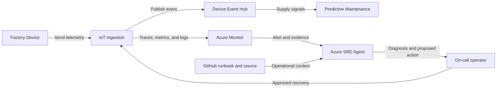

## Application overview

IoT Ingestion accepts synthetic device telemetry and represents the entry point
for manufacturing monitoring and predictive-maintenance signals. Failed ingestion
creates data gaps and delays detection of equipment risk.

| Attribute | Value |
|-----------|-------|
| Portfolio | Industrial and data |
| Business domain | Manufacturing |
| Business operation | `ingest-telemetry` |
| Critical dependency | `device-event-hub` |
| Availability objective | 99.9 percent |
| Latency objective | Under 400 ms |
| Demonstrated fault | Application error |
| Business impact | Factory telemetry is lost and maintenance signals arrive late |

The fault returns HTTP 500 from ingestion while health probes may remain normal.
The showcase uses synthetic devices and contains no factory data.

## Application architecture

The ingestion path supplies downstream maintenance signals. Azure SRE Agent
correlates application, revision, and stream evidence without accessing real
factory payloads or changing event partitions.

## Where Azure SRE Agent plays a role

Azure SRE Agent correlates ingestion errors with operation traces, revision
history, event-hub context, and business impact.

1. Detect failed `ingest-telemetry` operations.
2. Distinguish application error from stream and readiness failure.
3. Compare errors by revision and deployment time.
4. Explain telemetry-loss and maintenance-signal impact.
5. Recommend fault clearing or a correlated rollback for approval.
6. Verify successful synthetic ingestion after recovery.

The agent must not inspect real device payloads, replay events, change partitions,
access event-hub secrets, or connect to production equipment.

## Detection and triage

Investigate HTTP 500 responses from `ingest-telemetry`. Escalate when synthetic
data gaps continue or errors correlate with an active deployment.

Collect the error trace, revision, deployment timeline, event-hub context, health
status, and last successful ingestion.

## Investigation procedure

1. Confirm application metadata, SLO, and dependency.
2. Compare failed ingestion with liveness and readiness.
3. Inspect error traces and `device-event-hub` context.
4. Correlate fault onset with revision changes.
5. Verify that only synthetic device events are present.
6. Present probable cause, confidence, blast radius, and response.

## Mitigation

Approve clearing the bounded error fault. Roll back only a correlated revision.
Stream partition changes and event replay are outside showcase scope.

If errors continue, stop synthetic event generation and escalate to the ingestion
and event-stream owners.

## Recovery verification

1. Confirm both health probes succeed.
2. Submit three synthetic telemetry events.
3. Confirm HTTP 200 and latency under 400 ms.
4. Verify error rate returns to baseline.
5. Record approval, action, evidence, and recovery time.

Production recovery must address ordering, duplication, and data-gap reconciliation.
