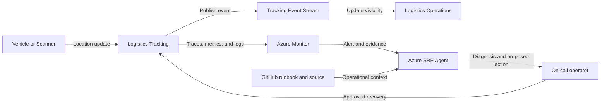

## Application overview

Logistics Tracking records synthetic shipment locations through an event stream.
The service supports shipment visibility and exception detection. When updates
stop, locations become stale and delayed deliveries can go unnoticed.

| Attribute | Value |
|-----------|-------|
| Portfolio | Industrial and data |
| Business domain | Transportation |
| Business operation | `record-location` |
| Critical dependency | `tracking-event-stream` |
| Availability objective | 99.9 percent |
| Latency objective | Under 900 ms |
| Demonstrated fault | Dependency unavailable |
| Business impact | Shipment locations become stale and exceptions are missed |

The dependency fault returns HTTP 503 while process health may remain normal.
Only synthetic shipment and location data is used.

## Application architecture

The event path updates shipment visibility. Azure SRE Agent evaluates service and
stream evidence without reading real shipment locations or replaying external
events.

## Azure resources for telemetry and investigation

| Azure resource or configuration | Requirement | Purpose |
|---------------------------------|-------------|---------|
| Dedicated resource group | Required | Isolates cost, RBAC, policy, alerts, and investigation scope |
| Log Analytics workspace | Deployed | Stores Container Apps console and system logs for 30 days |
| Workspace-based Application Insights | Deployed | Receives OpenTelemetry requests, traces, and custom metrics |
| Container Apps environment | Deployed | Sends application and platform logs to Log Analytics |
| Logistics Tracking Container App | Deployed | Provides revision, replica, ingress, probe, and scaling evidence |
| Azure Container Registry | Supporting | Stores the shared image used by the application revision |
| Workload managed identity | Supporting | Pulls the image with `AcrPull` |
| Azure Monitor alert rules | Add | Detect stream errors and stale updates; not in current Bicep |
| Application Insights availability test | Add | Tests `/health/ready` externally |
| Azure SRE Agent and agent identity | Deploy separately | Investigates with approved read access in Review mode |
| Azure Monitor and GitHub connections | Configure separately | Supply incident, source, metadata, and runbook context |
| Activity Log diagnostic setting | Recommended | Retains deployment and control-plane events |
| Action group and Key Vault | Recommended | Notify humans and protect demonstration secrets |

### Required Logistics Tracking signals

| Signal | Evidence to collect |
|--------|---------------------|
| Request telemetry | `POST /work`, status, duration, operation ID, and `service.name=logistics-tracking` |
| Business metric | `showcase.business.operations` with outcome and fault mode |
| Application log | `dependency_unavailable` with `dependency=tracking-event-stream` |
| Health | Liveness, readiness, and external availability |
| Platform | Revision, replica, ingress, scaling, deployment, CPU, and memory |
| Dependency | Add stream-client spans, publish errors, backlog, and freshness metrics in production |

Real shipment identifiers, customer addresses, routes, and precise locations must
not enter telemetry or SRE Agent context.

## Step-by-step telemetry configuration

1. Create a dedicated resource group with ownership, tags, budget, and policy.
2. Create Azure Container Registry and a workload identity with only `AcrPull`.
3. Deploy Log Analytics with approved retention and data access.
4. Create workspace-based Application Insights linked to the workspace.
5. Create the Container Apps environment and route platform and console logs.
6. Deploy Logistics Tracking with `APP_SLUG=logistics-tracking`, probes,
   Application Insights configuration, and the workload identity.
7. Verify sanitized request traces and business metrics use the Logistics
   Tracking service name.
8. Route Activity Log events to Log Analytics for deployment correlation.
9. Alert on 503 responses or `dependency_unavailable`, scoped by service,
   revision, and tracking stream.
10. Add a readiness availability test. In production, alert on publish failures,
    event backlog, and location freshness.
11. Deploy Azure SRE Agent separately with approved read and query roles, then
    connect Azure Monitor, Application Insights, and GitHub.
12. Configure Review mode, generate baseline and dependency-fault traffic, and
    verify the agent retrieves evidence and this runbook without location data.

## Where Azure SRE Agent plays a role

Azure SRE Agent connects request failures, dependency traces, revision state,
resource health, and location-freshness impact.

1. Detect failed `record-location` operations.
2. Correlate HTTP 503 responses with `tracking-event-stream`.
3. Exclude process, readiness, and deployment failures.
4. Explain stale visibility and missed-exception impact.
5. Recommend the bounded dependency-fault clear operation for approval.
6. Verify a new location update and telemetry recovery.

The agent must not purge or replay external streams, inspect real shipment data,
change producer configuration, or access stream credentials.

## Detection and triage

Investigate HTTP 503 responses referencing the tracking stream. Escalate when
updates are stale beyond the business threshold or multiple producers are affected.

Collect dependency spans, first failure time, revision, health status, and last
successful synthetic update.

## Investigation procedure

1. Confirm service metadata and objectives.
2. Compare failed updates with liveness and readiness.
3. Inspect `tracking-event-stream` dependency evidence.
4. Review deployment and resource health at fault onset.
5. Confirm only synthetic locations are involved.
6. Present probable cause, confidence, blast radius, and action.

## Mitigation

Approve clearing the bounded dependency fault. Do not purge, replay, or reroute
external streams during the showcase. If recovery fails, stop synthetic producers
and escalate to the stream owner.

## Recovery verification

1. Confirm readiness returns HTTP 200.
2. Record three synthetic locations and confirm HTTP 200.
3. Verify latency remains under 900 ms and errors stop.
4. Confirm location freshness resumes in demonstration telemetry.
5. Record approval, action, evidence, and recovery time.

Production replay requires ownership, ordering, and duplicate-handling controls.
