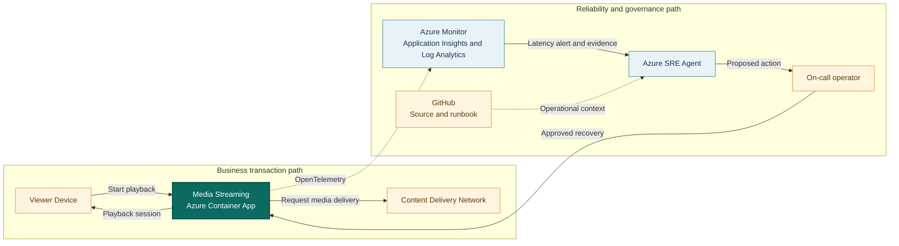

## Application overview

Media Streaming issues synthetic playback sessions and models the time between a
viewer selecting content and playback starting. Slow startup increases abandonment
and support demand even when requests return successfully.

| Attribute | Value |
|-----------|-------|
| Portfolio | Customer experience |
| Business domain | Media |
| Business operation | `start-playback` |
| Critical dependency | `content-delivery-network` |
| Availability objective | 99.95 percent |
| Latency objective | Under 350 ms |
| Demonstrated fault | Elevated latency |
| Business impact | Viewers abandon slow sessions and support demand increases |

The fault raises request duration while status and health remain successful,
demonstrating an experience incident rather than an availability outage.

## System context diagrams

The viewer path makes startup latency visible as a customer-experience concern.
Azure SRE Agent compares application and CDN timing without accessing viewing
history or changing content-delivery policy.

## Azure resources for telemetry and investigation

| Azure resource or configuration | Requirement | Purpose |
|---------------------------------|-------------|---------|
| Dedicated resource group | Required | Isolates cost, RBAC, policy, alerts, and investigation scope |
| Log Analytics workspace | Deployed | Stores Container Apps console and system logs for 30 days |
| Workspace-based Application Insights | Deployed | Receives OpenTelemetry requests, traces, and custom metrics |
| Container Apps environment | Deployed | Sends application and platform logs to Log Analytics |
| Media Streaming Container App | Deployed | Provides revision, replica, ingress, probe, and scaling evidence |
| Azure Container Registry | Supporting | Stores the shared image used by the application revision |
| Workload managed identity | Supporting | Pulls the image with `AcrPull` |
| Azure Monitor alert rules | Add | Detect startup latency and errors; not in the current Bicep |
| Application Insights availability test | Add | Tests `/health/ready` externally |
| Azure SRE Agent and agent identity | Deploy separately | Investigates with approved read access in Review mode |
| Azure Monitor and GitHub connections | Configure separately | Supply incident, source, metadata, and runbook context |
| Activity Log diagnostic setting | Recommended | Retains deployment and control-plane events |
| Action group and Key Vault | Recommended | Notify humans and protect demonstration secrets |

### Required Media Streaming signals

| Signal | Evidence to collect |
|--------|---------------------|
| Request telemetry | `POST /work`, duration, status, operation ID, and `service.name=media-streaming` |
| Business metric | `showcase.business.operations` with outcome and fault mode |
| Latency | Request percentiles compared with the 350 ms objective |
| Health | Liveness, readiness, and external availability |
| Platform | Revision, replica, ingress, scaling, deployment, CPU, and memory |
| Dependency | Instrument CDN-client spans and safe edge metrics in production |

Viewing history, subscriber identity, content keys, and signed URLs must remain
outside telemetry and agent context.

## Step-by-step telemetry configuration

1. Create a dedicated resource group with ownership, tags, budget, and policy.
2. Create Azure Container Registry and a workload identity with only `AcrPull`.
3. Deploy Log Analytics with approved retention and data access.
4. Create workspace-based Application Insights linked to the workspace.
5. Create the Container Apps environment and route platform and console logs.
6. Deploy Media Streaming with `APP_SLUG=media-streaming`, probes, Application
   Insights configuration, and the workload identity.
7. Verify request traces and business metrics use the Media Streaming service
   name and exclude viewing data.
8. Route Activity Log events to Log Analytics for deployment correlation.
9. Alert on sustained playback-start duration above 350 ms and on request errors,
   scoped by service and revision.
10. Add a readiness availability test. In production, add safe CDN availability,
    origin latency, and cache-health alerts.
11. Deploy Azure SRE Agent separately with approved read and query roles, then
    connect Azure Monitor, Application Insights, and GitHub.
12. Configure Review mode, generate baseline and latency traffic, and verify the
    agent retrieves timing, revision, impact, and runbook evidence.

## Where Azure SRE Agent plays a role

Azure SRE Agent correlates playback duration, dependency spans, revision state,
and resource metrics to locate latency without relying on HTTP failures.

1. Detect startup latency above 350 ms.
2. Compare end-to-end time with `content-delivery-network` span duration.
3. Exclude application compute, scaling, and readiness causes.
4. Describe viewer abandonment and support impact.
5. Recommend the bounded latency-fault clear operation for approval.
6. Verify sustained recovery across several playback sessions.

The agent must not inspect viewing history, alter CDN routing, access content
keys, or make unapproved capacity changes.

## Detection and triage

Investigate elevated duration while probes and response status remain healthy.
Increase priority when latency is sustained across multiple synthetic sessions.

Collect percentile duration, dependency spans, revision, utilization, and the
first SLO violation.

## Investigation procedure

1. Confirm metadata and the 350 ms objective.
2. Compare request duration with CDN dependency duration.
3. Review latency by revision and deployment timestamp.
4. Exclude replica allocation and resource saturation.
5. Confirm no customer viewing data is present.
6. State probable cause, confidence, impact, and reversible response.

## Mitigation

Approve clearing the bounded latency fault. CDN routing or cache-policy changes
are outside showcase scope and require production change approval.

## Recovery verification

1. Start three synthetic playback sessions.
2. Confirm each response succeeds below 350 ms.
3. Verify health remains normal and latency returns to baseline.
4. Confirm no new errors appear after mitigation.
5. Record approval, action, and recovery evidence.

Reverse any change that raises error rate or further delays playback.
