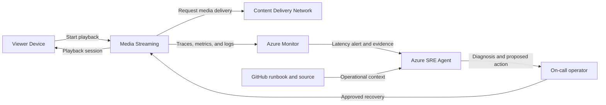

## Application overview

Media Streaming issues synthetic playback sessions and models the time between a
viewer selecting content and playback starting. Slow startup increases abandonment
and support demand even when requests return successfully.

| Attribute | Value |
|-----------|-------|
| Portfolio | Customer experience |
| Business domain | Media |
| Business operation | `start-playback` |
| Critical dependency | `content-delivery-network` |
| Availability objective | 99.95 percent |
| Latency objective | Under 350 ms |
| Demonstrated fault | Elevated latency |
| Business impact | Viewers abandon slow sessions and support demand increases |

The fault raises request duration while status and health remain successful,
demonstrating an experience incident rather than an availability outage.

## Application architecture

The viewer path makes startup latency visible as a customer-experience concern.
Azure SRE Agent compares application and CDN timing without accessing viewing
history or changing content-delivery policy.

## Where Azure SRE Agent plays a role

Azure SRE Agent correlates playback duration, dependency spans, revision state,
and resource metrics to locate latency without relying on HTTP failures.

1. Detect startup latency above 350 ms.
2. Compare end-to-end time with `content-delivery-network` span duration.
3. Exclude application compute, scaling, and readiness causes.
4. Describe viewer abandonment and support impact.
5. Recommend the bounded latency-fault clear operation for approval.
6. Verify sustained recovery across several playback sessions.

The agent must not inspect viewing history, alter CDN routing, access content
keys, or make unapproved capacity changes.

## Detection and triage

Investigate elevated duration while probes and response status remain healthy.
Increase priority when latency is sustained across multiple synthetic sessions.

Collect percentile duration, dependency spans, revision, utilization, and the
first SLO violation.

## Investigation procedure

1. Confirm metadata and the 350 ms objective.
2. Compare request duration with CDN dependency duration.
3. Review latency by revision and deployment timestamp.
4. Exclude replica allocation and resource saturation.
5. Confirm no customer viewing data is present.
6. State probable cause, confidence, impact, and reversible response.

## Mitigation

Approve clearing the bounded latency fault. CDN routing or cache-policy changes
are outside showcase scope and require production change approval.

## Recovery verification

1. Start three synthetic playback sessions.
2. Confirm each response succeeds below 350 ms.
3. Verify health remains normal and latency returns to baseline.
4. Confirm no new errors appear after mitigation.
5. Record approval, action, and recovery evidence.

Reverse any change that raises error rate or further delays playback.
