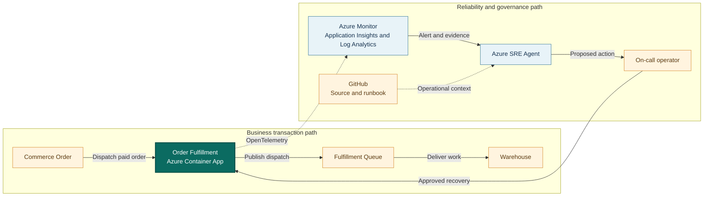

## Application overview

Order Fulfillment dispatches paid orders to fulfillment centers. It represents
the handoff between digital commerce and warehouse execution. Failed dispatches
delay paid orders and can cause warehouse service-level commitments to be missed.

| Attribute | Value |
|-----------|-------|
| Portfolio | Commerce and retail |
| Business domain | Supply chain |
| Business operation | `dispatch-order` |
| Critical dependency | `fulfillment-queue` |
| Availability objective | 99.9 percent |
| Latency objective | Under 800 ms |
| Demonstrated fault | Application error |
| Business impact | Paid orders are delayed and warehouse commitments are missed |

The error fault returns HTTP 500 from the business operation. Health probes may
remain successful, which separates transaction failure from platform readiness.

## System context diagrams

The business path carries paid orders to warehouse execution. The investigation
path lets Azure SRE Agent correlate dispatch failures with revisions and queue
evidence before an operator approves recovery.

## Azure resources for telemetry and investigation

| Azure resource or configuration | Requirement | Purpose |
|---------------------------------|-------------|---------|
| Dedicated resource group | Required | Isolates cost, RBAC, policy, alerts, and investigation scope |
| Log Analytics workspace | Deployed | Stores Container Apps console and system logs for 30 days |
| Workspace-based Application Insights | Deployed | Receives OpenTelemetry requests, traces, and custom metrics |
| Container Apps environment | Deployed | Sends application and platform logs to Log Analytics |
| Order Fulfillment Container App | Deployed | Provides revision, replica, ingress, probe, and scaling evidence |
| Azure Container Registry | Supporting | Stores the shared image used by the application revision |
| Workload managed identity | Supporting | Pulls the image with `AcrPull`; it is not the SRE Agent identity |
| Azure Monitor alert rules | Add | Detect dispatch errors and SLO breaches; not in the current Bicep |
| Application Insights availability test | Add | Tests `/health/ready` from outside the Container Apps environment |
| Azure SRE Agent and agent identity | Deploy separately | Investigates with Reader and monitoring access in Review mode |
| Azure Monitor and GitHub connections | Configure separately | Supply incident, source, metadata, and runbook context |
| Activity Log diagnostic setting | Recommended | Retains deployment and control-plane events in Log Analytics |
| Action group and Key Vault | Recommended | Notify humans and protect demonstration secrets |

### Required Order Fulfillment signals

| Signal | Evidence to collect |
|--------|---------------------|
| Request telemetry | `POST /work`, status, duration, operation ID, and `service.name=order-fulfillment` |
| Business metric | `showcase.business.operations` with outcome and fault-mode attributes |
| Application log | `synthetic_error` with `operation=dispatch-order` |
| Health | `/health/live` and `/health/ready` status and external availability |
| Platform | Revision, replica, ingress, scaling, deployment, CPU, and memory evidence |
| Dependency | Add queue-client spans and backlog metrics in production; the showcase records queue context only |

Queue telemetry must omit order payloads and expose only safe identifiers,
duration, result, backlog depth, and delivery outcome.

## Step-by-step telemetry configuration

1. Create a dedicated resource group and assign owners, tags, budget, and policy.
2. Create Azure Container Registry and a workload managed identity with only
   `AcrPull` on that registry.
3. Deploy Log Analytics with approved retention and access controls.
4. Create workspace-based Application Insights linked to that workspace.
5. Create the Container Apps environment and route console and system logs to
   Log Analytics.
6. Deploy Order Fulfillment with `APP_SLUG=order-fulfillment`, health probes,
   Application Insights configuration, and the workload identity.
7. Confirm OpenTelemetry exports request traces and the business metric with the
   Order Fulfillment service name.
8. Route Activity Log events to Log Analytics when deployment correlation is
   required.
9. Create an alert for HTTP 500 or `synthetic_error`, scoped to
   `dispatch-order`, service name, and revision.
10. Add a readiness availability test. In production, add queue backlog and
    oldest-message alerts from the actual messaging resource.
11. Deploy Azure SRE Agent separately with approved read and monitoring-query
    roles, then connect Azure Monitor, Application Insights, and GitHub.
12. Configure Review mode, generate baseline and fault traffic, and verify the
    agent retrieves errors, traces, metrics, revision context, business impact,
    and this runbook before an action is approved.

## Where Azure SRE Agent plays a role

Azure SRE Agent correlates dispatch errors with request traces, active revisions,
queue context, deployment history, and the order-flow business impact.

1. Detect failed `dispatch-order` operations and quantify the affected window.
2. Determine whether the symptom is application error, readiness loss, or queue
   dependency failure.
3. Compare failures across revisions and recent deployments.
4. Explain the risk to paid orders and warehouse commitments.
5. Propose fault clearing or a correlated revision rollback for approval.
6. Verify a new synthetic dispatch and monitor error recovery.

The agent must not replay production orders, purge a queue, inspect customer
order content, modify warehouse systems, or perform an unapproved rollback.

## Detection and triage

Investigate HTTP 500 responses from `dispatch-order`. Escalate when failures are
sustained, paid-order backlog is growing, or multiple fulfillment regions are
affected.

Collect the first error time, active revision, error trace, queue dependency
context, deployment history, and last successful dispatch.

## Investigation procedure

1. Confirm the application contract and SLO through `/api/metadata`.
2. Compare business failures with liveness and readiness.
3. Inspect error traces and identify the failing operation.
4. Compare error rate by revision and correlate with deployments.
5. Check `fulfillment-queue` evidence without reading message contents.
6. Present probable cause, confidence, blast radius, and reversible response.

## Mitigation

Approve clearing the bounded error fault. Roll back a revision only when the
evidence correlates that revision with the incident. Production replay or queue
intervention requires a separate idempotency and ownership procedure.

If errors continue, stop synthetic producers and escalate to the fulfillment
application and queue owners.

## Recovery verification

1. Confirm health probes are successful.
2. Dispatch three synthetic orders and confirm HTTP 200.
3. Verify latency remains under 800 ms and error rate returns to baseline.
4. Confirm no backlog symptom remains in the demonstration evidence.
5. Record the approved action, recovery result, and required follow-up.

Reverse the approved change if it increases errors or creates readiness loss.
