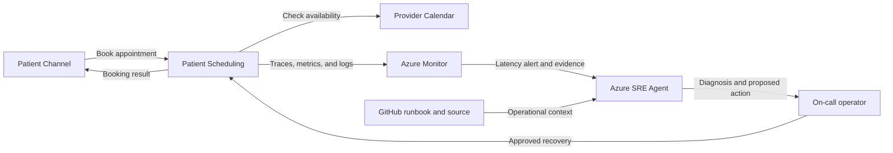

## Application overview

Patient Scheduling books synthetic clinical appointments against provider
calendar availability. It models a patient-facing access channel where delay
prevents self-service booking and increases contact-center demand.

| Attribute | Value |
|-----------|-------|
| Portfolio | Customer experience |
| Business domain | Healthcare |
| Business operation | `book-appointment` |
| Critical dependency | `provider-calendar` |
| Availability objective | 99.95 percent |
| Latency objective | Under 600 ms |
| Demonstrated fault | Elevated latency |
| Business impact | Patients cannot book care and contact-center volume rises |

The latency fault preserves successful health probes and status codes. The
incident is visible through request duration and business telemetry.

## Application architecture

The patient journey depends on provider-calendar responsiveness. Azure SRE Agent
uses operational timing evidence without accessing patient, appointment, or
clinical records.

## Azure resources for telemetry and investigation

| Azure resource or configuration | Requirement | Purpose |
|---------------------------------|-------------|---------|
| Dedicated resource group | Required | Isolates cost, RBAC, policy, alerts, and investigation scope |
| Log Analytics workspace | Deployed | Stores Container Apps console and system logs for 30 days |
| Workspace-based Application Insights | Deployed | Receives OpenTelemetry requests, traces, and custom metrics |
| Container Apps environment | Deployed | Sends application and platform logs to Log Analytics |
| Patient Scheduling Container App | Deployed | Provides revision, replica, ingress, probe, and scaling evidence |
| Azure Container Registry | Supporting | Stores the shared image used by the application revision |
| Workload managed identity | Supporting | Pulls the image with `AcrPull`; it has no clinical access |
| Azure Monitor alert rules | Add | Detect booking latency and errors; not in the current Bicep |
| Application Insights availability test | Add | Tests `/health/ready` externally |
| Azure SRE Agent and agent identity | Deploy separately | Investigates with approved read access in Review mode |
| Azure Monitor and GitHub connections | Configure separately | Supply incident, source, metadata, and runbook context |
| Activity Log diagnostic setting | Recommended | Retains deployment and control-plane events |
| Action group and Key Vault | Recommended | Notify humans and protect demonstration secrets |

### Required Patient Scheduling signals

| Signal | Evidence to collect |
|--------|---------------------|
| Request telemetry | `POST /work`, duration, status, operation ID, and `service.name=patient-scheduling` |
| Business metric | `showcase.business.operations` with outcome and fault mode |
| Latency | Request percentiles compared with the 600 ms objective |
| Health | Liveness, readiness, and external availability |
| Platform | Revision, replica, ingress, scaling, deployment, CPU, and memory |
| Dependency | Instrument calendar-client spans in production without patient or appointment data |

Patient identifiers, appointment details, diagnoses, provider notes, and other
clinical data must remain outside telemetry and agent context.

## Step-by-step telemetry configuration

1. Create a dedicated resource group with healthcare ownership, budget, policy,
   and access review.
2. Create Azure Container Registry and a workload identity with only `AcrPull`.
3. Deploy Log Analytics with approved retention and restricted access.
4. Create workspace-based Application Insights linked to the workspace.
5. Create the Container Apps environment and route platform and console logs.
6. Deploy Patient Scheduling with `APP_SLUG=patient-scheduling`, probes,
   Application Insights configuration, and the workload identity.
7. Verify sanitized request traces and business metrics use the Patient
   Scheduling service name.
8. Route Activity Log events to Log Analytics for deployment correlation.
9. Alert on sustained scheduling duration above 600 ms and on request errors,
   scoped by service and revision.
10. Add a readiness availability test and human-notification action group.
11. Deploy Azure SRE Agent separately with approved read and query roles, then
    connect Azure Monitor, Application Insights, and GitHub.
12. Configure Review mode, generate baseline and latency traffic, and verify the
    agent receives operational evidence and this runbook without clinical data.

## Where Azure SRE Agent plays a role

Azure SRE Agent correlates latency telemetry, calendar dependency spans, revision
timing, and resource health while keeping clinical and patient data out of scope.

1. Detect sustained booking latency above 600 ms.
2. Compare end-to-end duration with `provider-calendar` span duration.
3. Exclude compute saturation, readiness, and revision rollout.
4. Explain patient-access and contact-center impact.
5. Recommend the bounded latency-fault clear operation for approval.
6. Verify several synthetic bookings after recovery.

The agent must not access patient records, appointment details, clinical systems,
secrets, or real provider calendars.

## Detection and triage

Investigate sustained latency above the objective with successful probes. Increase
priority when failures or abandonment indicators accompany the delay.

Collect percentile duration, dependency spans, revision, resource utilization,
and the first SLO breach.

## Investigation procedure

1. Confirm service metadata and the 600 ms objective.
2. Compare request and `provider-calendar` duration.
3. Review latency by revision and deployment time.
4. Exclude replica scaling or platform saturation.
5. Confirm every record and dependency is synthetic.
6. Present probable cause, confidence, impact, and proposed action.

## Mitigation

Approve clearing the bounded latency fault. Do not connect the exercise to a
clinical system or patient dataset. Production calendar failover must follow the
healthcare organization's continuity and privacy procedures.

## Recovery verification

1. Book three synthetic appointments.
2. Confirm each response succeeds below 600 ms.
3. Verify health remains normal and latency returns to baseline.
4. Confirm no patient data was used or exposed.
5. Record approval, evidence, action, and recovery time.

Revert any demonstration configuration that creates continued delay.
