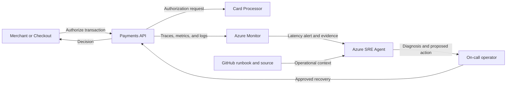

## Application overview

Payments API authorizes synthetic payment transactions through a latency-sensitive
card processor. It represents a regulated revenue-path service where delayed
responses can become timeouts, failed purchases, and duplicate retry risk.

| Attribute | Value |
|-----------|-------|
| Portfolio | Financial services |
| Business domain | Financial services |
| Business operation | `authorize-payment` |
| Critical dependency | `card-processor` |
| Availability objective | 99.99 percent |
| Latency objective | Under 300 ms |
| Demonstrated fault | Elevated latency |
| Business impact | Transactions time out, fail, and cause merchants to lose sales |

The latency fault keeps status and health successful while request duration
exceeds the objective. Operators must evaluate customer experience, not only
HTTP status.

## Application architecture

The payment path remains isolated from the operational path. Azure SRE Agent uses
timing and dependency evidence without reading cardholder data or changing the
processor.

## Where Azure SRE Agent plays a role

Azure SRE Agent correlates duration metrics, traces, revision state, resource
utilization, and processor dependency evidence while respecting payment-data
boundaries.

1. Detect SLO latency violation even when requests still return HTTP 200.
2. Compare duration by revision and dependency span.
3. Exclude CPU, memory, replica, ingress, and readiness causes.
4. Explain timeout and transaction-loss risk without reading payment data.
5. Recommend the bounded latency-fault clear operation for approval.
6. Verify sustained latency recovery with multiple synthetic authorizations.

The agent must not access cardholder data, secrets, or transaction payloads. It
must not switch processors, alter financial records, or grant itself write access.

## Detection and triage

Investigate sustained request duration above 300 ms without readiness failure.
Increase severity when authorization errors rise or Retail Checkout reports a
correlated conversion impact.

Collect percentile latency, affected revision, processor spans, replica metrics,
and the timestamp of the first SLO violation.

## Investigation procedure

1. Confirm service metadata and the 300 ms objective.
2. Compare end-to-end duration with `card-processor` span duration.
3. Review latency by active revision and deployment time.
4. Exclude platform saturation and scaling delay.
5. Check for correlated checkout failures without inspecting transaction data.
6. State probable cause, confidence, impact, and reversible action.

## Mitigation

Approve clearing the bounded latency fault. Production response requires
payment-team-owned timeout, circuit-breaker, and provider-failover controls.
Never change a processor route or retry policy without financial risk approval.

## Recovery verification

1. Submit at least three synthetic authorizations.
2. Confirm each response succeeds below 300 ms.
3. Verify health remains normal and error rate does not increase.
4. Confirm correlated checkout latency recovers.
5. Record the evidence, approval, action, and recovery time.

Roll back any configuration or revision change that worsens error rate or
introduces duplicate-processing risk.
