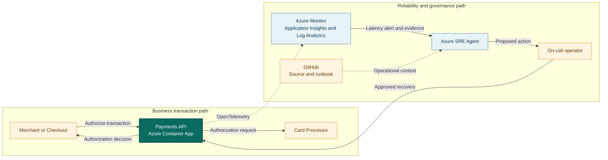

## Application overview

Payments API authorizes synthetic payment transactions through a latency-sensitive
card processor. It represents a regulated revenue-path service where delayed
responses can become timeouts, failed purchases, and duplicate retry risk.

| Attribute | Value |
|-----------|-------|
| Portfolio | Financial services |
| Business domain | Financial services |
| Business operation | `authorize-payment` |
| Critical dependency | `card-processor` |
| Availability objective | 99.99 percent |
| Latency objective | Under 300 ms |
| Demonstrated fault | Elevated latency |
| Business impact | Transactions time out, fail, and cause merchants to lose sales |

The latency fault keeps status and health successful while request duration
exceeds the objective. Operators must evaluate customer experience, not only
HTTP status.

## System context diagrams



The payment path remains isolated from the operational path. Azure SRE Agent uses
timing and dependency evidence without reading cardholder data or changing the
processor.

## Azure resources for telemetry and investigation

| Azure resource or configuration | Requirement | Purpose |
|---------------------------------|-------------|---------|
| Dedicated resource group | Required | Isolates cost, RBAC, policy, alerts, and investigation scope |
| Log Analytics workspace | Deployed | Stores Container Apps console and system logs for 30 days |
| Workspace-based Application Insights | Deployed | Receives OpenTelemetry requests, traces, and custom metrics |
| Container Apps environment | Deployed | Sends application and platform logs to Log Analytics |
| Payments API Container App | Deployed | Provides revision, replica, ingress, probe, and scaling evidence |
| Azure Container Registry | Supporting | Stores the shared image used by the application revision |
| Workload managed identity | Supporting | Pulls the image with `AcrPull`; it is not the SRE Agent identity |
| Azure Monitor alert rules | Add | Detect authorization latency and errors; not in the current Bicep |
| Application Insights availability test | Add | Tests `/health/ready` from outside the Container Apps environment |
| Azure SRE Agent and agent identity | Deploy separately | Investigates with Reader and monitoring access in Review mode |
| Azure Monitor and GitHub connections | Configure separately | Supply incident, source, metadata, and runbook context |
| Activity Log diagnostic setting | Recommended | Retains deployment and control-plane events in Log Analytics |
| Action group and Key Vault | Recommended | Notify humans and protect demonstration secrets |

### Required Payments API signals

| Signal | Evidence to collect |
|--------|---------------------|
| Request telemetry | `POST /work`, duration, status, operation ID, and `service.name=payments-api` |
| Business metric | `showcase.business.operations` with outcome and fault-mode attributes |
| Latency | Request percentiles compared with the 300 ms objective |
| Health | `/health/live` and `/health/ready` status and external availability |
| Platform | Revision, replica, ingress, scaling, deployment, CPU, and memory evidence |
| Dependency | Instrument processor-client spans in production without payment payloads |

Cardholder data, authorization tokens, account identifiers, and processor secrets
must never appear in telemetry or SRE Agent context.

## Step-by-step telemetry configuration

### Step 1: Establish the resource and governance boundary

Create a dedicated non-production resource group for the Payments API showcase.
Assign a named technical owner, business owner, cost center, environment,
classification, and expiry date.

Azure best practices:

* Keep the showcase separate from production payment resources and data.
* Apply least-privilege RBAC at the resource-group scope.
* Use Azure Policy to require tags, approved regions, diagnostic settings, and
  secure transport.
* Create a budget with 50, 75, 90, and 100 percent notifications.
* Deny public deployment of unrelated resource types into the boundary.

Expected evidence:

```text
Resource scope: rg-sre-agent-showcase
Environment: non-production
Data classification: synthetic
Owner and expiry tags: present
Budget and policy assignments: active
```

### Step 2: Secure image storage and workload identity

Create Azure Container Registry and a user-assigned managed identity for the
Payments API workload. Assign `AcrPull` to that identity at the registry scope.

Azure best practices:

* Disable the registry administrator account.
* Use managed identity instead of registry passwords.
* Scope `AcrPull` to the registry, not the subscription.
* Keep workload identity separate from the Azure SRE Agent identity.
* Enable image scanning and use immutable image tags or digests for releases.
* Do not grant the workload identity access to payment systems or telemetry
  administration.

Expected evidence:

```text
Image source: approved Azure Container Registry
Authentication: user-assigned managed identity
Workload role: AcrPull only
Registry admin credentials: disabled
Image revision: traceable to an immutable build
```

### Step 3: Create the Log Analytics workspace

Deploy a Log Analytics workspace for Container Apps console logs, system logs,
and retained diagnostic data. The showcase uses 30-day retention.

Azure best practices:

* Select retention from operational and regulatory requirements.
* Restrict workspace query access with least-privilege RBAC.
* Set a daily cap and ingestion alert for the MVP.
* Exclude payment payloads, tokens, account identifiers, and authorization data.
* Use table plans deliberately. Confirm feature support before moving a table
  from Analytics Logs to a lower-cost plan.
* Monitor ingestion volume before increasing retention.

Expected evidence:

```text
Workspace retention: 30 days
ContainerAppConsoleLogs_CL: receiving Payments API logs
ContainerAppSystemLogs_CL: receiving revision and replica events
Sensitive payment fields: absent
Daily cap and ingestion monitoring: configured
```

### Step 4: Create workspace-based Application Insights

Create Application Insights and link it to the Log Analytics workspace. Supply
its connection string to the Payments API runtime through configuration.

Azure best practices:

* Use workspace-based Application Insights for unified queries and access control.
* Keep one stable `service.name` for the logical Payments API.
* Use `service.version`, deployment environment, and revision attributes for
  release correlation.
* Apply sampling only after confirming low-volume errors remain visible.
* Configure data collection rules and telemetry processors to remove sensitive
  attributes before export.
* Treat the connection string as configuration and prevent uncontrolled changes.

Expected evidence:

```text
Application Insights mode: workspace based
Linked workspace: expected Log Analytics resource
Cloud role or service name: payments-api
Request and trace correlation: working
Payment payload collection: disabled
```

### Step 5: Configure the Container Apps environment

Create the Azure Container Apps environment and configure its log destination as
the Log Analytics workspace.

Azure best practices:

* Use one environment as the non-production network and observability boundary.
* Require HTTPS ingress and disable insecure transport.
* Route console and system logs to the approved workspace.
* Monitor revision provisioning, replica starts, probe failures, and scaling.
* Use internal ingress or private networking for a production payment workload.
* Keep the environment ephemeral for MVP sessions when stable hostnames are not
  required.

Expected evidence:

```text
Log destination: expected Log Analytics workspace
Ingress transport: HTTPS only
Revision and replica events: queryable
Environment scope: non-production showcase
```

### Step 6: Deploy and harden Payments API

Deploy the container with `APP_SLUG=payments-api`,
`DEPLOYMENT_ENVIRONMENT=<environment>`, health probes, the Application Insights
connection string, and the workload identity.

Azure best practices:

* Pin the image by digest for a controlled release.
* Keep active revision mode aligned with the rollout strategy.
* Use separate liveness and readiness probes.
* Set CPU, memory, minimum replicas, maximum replicas, and concurrency explicitly.
* Keep `minimumReplicas=0` for the MVP except during scheduled demonstrations.
* Store the demonstration key as a secret reference. Never log it.
* Disable fault injection outside controlled non-production sessions.

Expected evidence:

```text
Application slug: payments-api
Liveness path: /health/live
Readiness path: /health/ready
Revision image: approved digest
Fault injection: disabled by default
Replica bounds and resource limits: explicit
```

### Step 7: Configure and validate OpenTelemetry

Initialize Azure Monitor OpenTelemetry before serving requests. Instrument FastAPI
requests and emit the `showcase.business.operations` counter.

Azure best practices:

* Use stable resource attributes for service name, namespace, version, revision,
  and environment.
* Preserve W3C trace context across every instrumented dependency.
* Add payment-processor client instrumentation in production.
* Never attach cardholder data, authorization tokens, request bodies, or account
  identifiers to spans, logs, or metrics.
* Avoid high-cardinality metric dimensions such as transaction identifiers.
* Filter successful health-probe traces when they create unnecessary volume.

Expected evidence:

```text
service.name: payments-api
service.namespace: sre-agent-enterprise-showcase
Request route: POST /work
Business metric: showcase.business.operations
Metric dimensions: application, fault.mode, outcome
Sensitive attributes: absent
```

> [!NOTE]
> The showcase simulates processor latency inside the application. It does not
> make a real card-processor call or emit a processor dependency span. A
> production implementation must instrument the actual processor client.

### Step 8: Retain Azure control-plane activity

Create a subscription or resource-group diagnostic setting that routes relevant
Azure Activity Log categories to Log Analytics.

Azure best practices:

* Capture administrative, policy, security, service-health, and resource-health
  events required by the operating model.
* Restrict access to role-assignment and administrative event data.
* Correlate deployment events by resource ID, caller, operation, and timestamp.
* Avoid duplicating the same diagnostic stream into multiple destinations unless
  retention or security requirements justify it.
* Use immutable deployment identifiers in release records.

Expected evidence:

```text
AzureActivity: receiving selected categories
Container App resource ID: queryable
Revision deployment time and caller: available
Policy and role-assignment changes: auditable
```

### Step 9: Create actionable latency and error alerts

Create an Azure Monitor alert for sustained Payments API latency above the
300 ms objective and a separate alert for elevated server errors.

Azure best practices:

* Use percentile latency rather than averages.
* Require a minimum request count before evaluating latency.
* Start with a five-minute evaluation window and tune it from observed traffic.
* Scope by `service.name=payments-api` and retain revision as investigation
  context.
* Avoid high-cardinality alert dimensions.
* Add cooldown or suppression to prevent duplicate agent investigations.
* Attach an action group only to approved human-notification channels.
* Use multi-window burn-rate alerts for production SLOs.

Recommended MVP alert logic:

| Alert | Initial condition | Severity |
|-------|-------------------|----------|
| Authorization latency | p95 duration above 300 ms for 5 minutes with at least 20 requests | Sev 2 |
| Authorization errors | Server error rate above 5 percent for 5 minutes | Sev 1 |
| Telemetry absence | No Payments API requests during an expected test window | Sev 3 |

Expected evidence:

```text
Alert scope: Payments API Application Insights
Service filter: payments-api
Latency threshold: p95 > 300 ms
Evaluation window: 5 minutes
Response-plan label: SRE-SHOWCASE
```

### Step 10: Add external availability and dependency monitoring

Create an Application Insights standard availability test for
`/health/ready`. Use multiple Azure test locations when the evaluation requires
external-path coverage.

Azure best practices:

* Test readiness rather than liveness for traffic eligibility.
* Validate HTTPS, status code, response body, and certificate health.
* Use at least two locations for a production-facing availability decision.
* Alert only after consecutive or multi-location failures.
* Do not place secrets or destructive operations in a web test.
* In production, add safe processor availability, duration, timeout, and
  circuit-breaker telemetry from the actual dependency client.

Expected evidence:

```text
Test URL: https://<payments-api-host>/health/ready
Expected status: 200
Transport: HTTPS
Test frequency: 5 minutes
Failure policy: consecutive or multi-location confirmation
```

### Step 11: Deploy and connect Azure SRE Agent

Deploy Azure SRE Agent separately from the application and assign it a distinct
user-assigned managed identity. Connect Azure Monitor, Application Insights, and
this GitHub repository.

Azure best practices:

* Begin with Reader mode and the minimum monitoring-query permissions required by
  the official setup.
* Scope Azure access to the showcase resource group.
* Grant write permissions only for named, tested remediation actions.
* Keep secret retrieval, role assignment, and resource deletion denied.
* Limit repository access to the required repository and branch.
* Validate each connector independently before enabling a response plan.
* Review agent identity and connector permissions regularly.

Expected evidence:

```text
Agent identity: separate from workload identity
Azure scope: showcase resource group
Default posture: read only
Monitoring queries: successful
GitHub source and runbook: retrievable
Delete, secret-read, and role-assignment tools: denied
```

### Step 12: Configure and validate the governed response

Create a response plan filtered to the Payments API alert labels. Use Review mode
so an operator approves every write action.

Azure best practices:

* Filter by service, environment, alert title, and severity.
* Set reinvestigation cooldown and an AAU allocation limit.
* Require the agent to state evidence, probable cause, confidence, business
  impact, proposed action, risk, rollback, and verification.
* Approve only reversible actions already authorized by this runbook.
* Verify recovery with both technical health and synthetic business operations.
* Retain the investigation transcript and approval record.
* Reject any response containing payment data or unsupported claims.

Validation sequence:

1. Generate healthy baseline requests.
2. Confirm request traces, metrics, logs, and revision context.
3. Activate the bounded latency fault.
4. Generate enough synthetic traffic to satisfy the alert's minimum count.
5. Confirm the response plan starts one investigation.
6. Review the agent's evidence and proposed fault-clear operation.
7. Approve the action only when the evidence and scope are correct.
8. Submit three successful authorizations under 300 ms.
9. Confirm the alert resolves and no error-rate regression appears.

Expected evidence:

```text
Response mode: Review
Investigation scope: payments-api and non-production resources
Required approval: recorded
Recovery test: three successful operations under 300 ms
Sensitive payment data: absent
```

## Illustrative Azure SRE Agent outputs

The following outputs are examples for the synthetic showcase. They are not live
agent transcripts and must not be treated as evidence for a real incident.

### Sample investigation summary

```text
Incident: PAYMENTS-LATENCY-001
Service: payments-api
Environment: demo
Severity: Sev 2

Observed symptom:
- p95 POST /work duration reached 1.04 seconds for 5 minutes.
- The service objective is below 300 ms.
- Requests continued to return HTTP 200.

Correlated evidence:
- /health/live and /health/ready remained successful.
- CPU, memory, replica count, and ingress errors remained at baseline.
- No Container App revision deployment occurred near the first breach.
- showcase.business.operations reported fault.mode=latency.
- No payment payload, account identifier, or authorization token was collected.

Probable cause:
The bounded synthetic latency fault is active in Payments API. The showcase does
not call a real card processor, so processor degradation is not established.

Business impact:
Authorization responses can exceed merchant timeouts, causing failed purchases
and retry risk.

Confidence: 94 percent
```

### Sample proposed action

```text
Proposed action: Clear the bounded Payments API latency fault.
Target: payments-api demonstration fault state
Mode: Review
Approval required: Yes

Risk:
Low. The action changes only in-memory synthetic fault state.

Explicitly excluded:
- No processor routing change
- No payment replay
- No secret retrieval
- No role assignment
- No resource deletion

Rollback:
No platform rollback is required. If validation fails, stop synthetic traffic and
escalate without broadening permissions.

Verification:
1. Confirm readiness returns HTTP 200.
2. Run three synthetic authorizations.
3. Confirm each completes below 300 ms.
4. Confirm latency alert resolves without increased errors.
```

### Sample recovery report

```text
Recovery status: Verified
Approved by: On-call operator
Action: Cleared bounded latency fault

Validation:
- Readiness: HTTP 200
- Synthetic authorizations: 3 of 3 successful
- Observed durations: 42 ms, 47 ms, 44 ms
- Server error rate: 0 percent
- Latency alert: Resolved
- New revision deployed: No
- Sensitive data observed: No

Follow-up:
Instrument the real processor client before production adoption so downstream
latency can be separated from application processing time.
```

## Azure best-practice references

* [Azure Container Apps observability](https://learn.microsoft.com/en-us/azure/container-apps/observability)
* [Monitor logs with Log Analytics](https://learn.microsoft.com/en-us/azure/container-apps/log-monitoring)
* [Application Insights OpenTelemetry overview](https://learn.microsoft.com/en-us/azure/azure-monitor/app/app-insights-overview)
* [Configure OpenTelemetry in Application Insights](https://learn.microsoft.com/en-us/azure/azure-monitor/app/opentelemetry-configuration)
* [Azure SRE Agent identity](https://learn.microsoft.com/en-us/azure/sre-agent/agent-identity)
* [Manage Azure SRE Agent permissions](https://learn.microsoft.com/en-us/azure/sre-agent/manage-permissions)
* [Create an incident response plan](https://learn.microsoft.com/en-us/azure/sre-agent/response-plan)
* [Connect GitHub to Azure SRE Agent](https://learn.microsoft.com/en-us/azure/sre-agent/github-connector)

## Where Azure SRE Agent plays a role

Azure SRE Agent correlates duration metrics, traces, revision state, resource
utilization, and processor dependency evidence while respecting payment-data
boundaries.

1. Detect SLO latency violation even when requests still return HTTP 200.
2. Compare duration by revision and synthetic fault state. In production,
   compare it with the instrumented processor dependency span.
3. Exclude CPU, memory, replica, ingress, and readiness causes.
4. Explain timeout and transaction-loss risk without reading payment data.
5. Recommend the bounded latency-fault clear operation for approval.
6. Verify sustained latency recovery with multiple synthetic authorizations.

The agent must not access cardholder data, secrets, or transaction payloads. It
must not switch processors, alter financial records, or grant itself write access.

## Detection and triage

Investigate sustained request duration above 300 ms without readiness failure.
Increase severity when authorization errors rise or Retail Checkout reports a
correlated conversion impact.

Collect percentile latency, affected revision, processor spans, replica metrics,
and the timestamp of the first SLO violation.

## Investigation procedure

1. Confirm service metadata and the 300 ms objective.
2. In the showcase, correlate end-to-end duration with the active synthetic
   fault. In production, compare it with `card-processor` span duration.
3. Review latency by active revision and deployment time.
4. Exclude platform saturation and scaling delay.
5. Check for correlated checkout failures without inspecting transaction data.
6. State probable cause, confidence, impact, and reversible action.

## Mitigation

Approve clearing the bounded latency fault. Production response requires
payment-team-owned timeout, circuit-breaker, and provider-failover controls.
Never change a processor route or retry policy without financial risk approval.

## Recovery verification

1. Submit at least three synthetic authorizations.
2. Confirm each response succeeds below 300 ms.
3. Verify health remains normal and error rate does not increase.
4. Confirm correlated checkout latency recovers.
5. Record the evidence, approval, action, and recovery time.

Roll back any configuration or revision change that worsens error rate or
introduces duplicate-processing risk.
