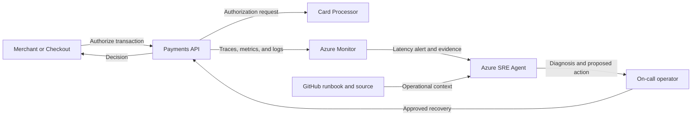

## Application overview

Payments API authorizes synthetic payment transactions through a latency-sensitive
card processor. It represents a regulated revenue-path service where delayed
responses can become timeouts, failed purchases, and duplicate retry risk.

| Attribute | Value |
|-----------|-------|
| Portfolio | Financial services |
| Business domain | Financial services |
| Business operation | `authorize-payment` |
| Critical dependency | `card-processor` |
| Availability objective | 99.99 percent |
| Latency objective | Under 300 ms |
| Demonstrated fault | Elevated latency |
| Business impact | Transactions time out, fail, and cause merchants to lose sales |

The latency fault keeps status and health successful while request duration
exceeds the objective. Operators must evaluate customer experience, not only
HTTP status.

## Application architecture

The payment path remains isolated from the operational path. Azure SRE Agent uses
timing and dependency evidence without reading cardholder data or changing the
processor.

## Azure resources for telemetry and investigation

| Azure resource or configuration | Requirement | Purpose |
|---------------------------------|-------------|---------|
| Dedicated resource group | Required | Isolates cost, RBAC, policy, alerts, and investigation scope |
| Log Analytics workspace | Deployed | Stores Container Apps console and system logs for 30 days |
| Workspace-based Application Insights | Deployed | Receives OpenTelemetry requests, traces, and custom metrics |
| Container Apps environment | Deployed | Sends application and platform logs to Log Analytics |
| Payments API Container App | Deployed | Provides revision, replica, ingress, probe, and scaling evidence |
| Azure Container Registry | Supporting | Stores the shared image used by the application revision |
| Workload managed identity | Supporting | Pulls the image with `AcrPull`; it is not the SRE Agent identity |
| Azure Monitor alert rules | Add | Detect authorization latency and errors; not in the current Bicep |
| Application Insights availability test | Add | Tests `/health/ready` from outside the Container Apps environment |
| Azure SRE Agent and agent identity | Deploy separately | Investigates with Reader and monitoring access in Review mode |
| Azure Monitor and GitHub connections | Configure separately | Supply incident, source, metadata, and runbook context |
| Activity Log diagnostic setting | Recommended | Retains deployment and control-plane events in Log Analytics |
| Action group and Key Vault | Recommended | Notify humans and protect demonstration secrets |

### Required Payments API signals

| Signal | Evidence to collect |
|--------|---------------------|
| Request telemetry | `POST /work`, duration, status, operation ID, and `service.name=payments-api` |
| Business metric | `showcase.business.operations` with outcome and fault-mode attributes |
| Latency | Request percentiles compared with the 300 ms objective |
| Health | `/health/live` and `/health/ready` status and external availability |
| Platform | Revision, replica, ingress, scaling, deployment, CPU, and memory evidence |
| Dependency | Instrument processor-client spans in production without payment payloads |

Cardholder data, authorization tokens, account identifiers, and processor secrets
must never appear in telemetry or SRE Agent context.

## Step-by-step telemetry configuration

1. Create a dedicated resource group and assign owners, tags, budget, and policy.
2. Create Azure Container Registry and a workload managed identity with only
   `AcrPull` on that registry.
3. Deploy Log Analytics with approved retention and restricted data access.
4. Create workspace-based Application Insights linked to that workspace.
5. Create the Container Apps environment and route platform and console logs to
   Log Analytics.
6. Deploy Payments API with `APP_SLUG=payments-api`, probes, the Application
   Insights connection string, and the workload identity.
7. Confirm OpenTelemetry exports request traces and business metrics with the
   Payments API service name and no sensitive attributes.
8. Route Activity Log events to Log Analytics for deployment correlation.
9. Create a latency alert for sustained duration above 300 ms, scoped by service
   name and revision, plus an error-rate alert.
10. Add a readiness availability test. In production, add safe processor
    dependency duration and availability alerts.
11. Deploy Azure SRE Agent separately with approved read and monitoring-query
    roles, then connect Azure Monitor, Application Insights, and GitHub.
12. Configure Review mode, generate baseline and latency traffic, and verify the
    agent retrieves SLO, trace, metric, revision, processor context, impact, and
    this runbook without receiving payment data.

## Where Azure SRE Agent plays a role

Azure SRE Agent correlates duration metrics, traces, revision state, resource
utilization, and processor dependency evidence while respecting payment-data
boundaries.

1. Detect SLO latency violation even when requests still return HTTP 200.
2. Compare duration by revision and dependency span.
3. Exclude CPU, memory, replica, ingress, and readiness causes.
4. Explain timeout and transaction-loss risk without reading payment data.
5. Recommend the bounded latency-fault clear operation for approval.
6. Verify sustained latency recovery with multiple synthetic authorizations.

The agent must not access cardholder data, secrets, or transaction payloads. It
must not switch processors, alter financial records, or grant itself write access.

## Detection and triage

Investigate sustained request duration above 300 ms without readiness failure.
Increase severity when authorization errors rise or Retail Checkout reports a
correlated conversion impact.

Collect percentile latency, affected revision, processor spans, replica metrics,
and the timestamp of the first SLO violation.

## Investigation procedure

1. Confirm service metadata and the 300 ms objective.
2. Compare end-to-end duration with `card-processor` span duration.
3. Review latency by active revision and deployment time.
4. Exclude platform saturation and scaling delay.
5. Check for correlated checkout failures without inspecting transaction data.
6. State probable cause, confidence, impact, and reversible action.

## Mitigation

Approve clearing the bounded latency fault. Production response requires
payment-team-owned timeout, circuit-breaker, and provider-failover controls.
Never change a processor route or retry policy without financial risk approval.

## Recovery verification

1. Submit at least three synthetic authorizations.
2. Confirm each response succeeds below 300 ms.
3. Verify health remains normal and error rate does not increase.
4. Confirm correlated checkout latency recovers.
5. Record the evidence, approval, action, and recovery time.

Roll back any configuration or revision change that worsens error rate or
introduces duplicate-processing risk.
