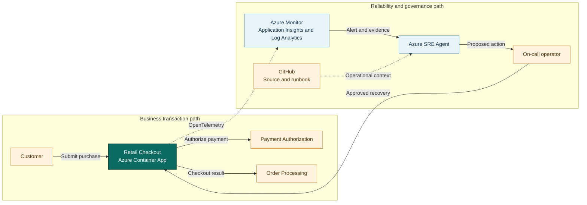

## Application overview

Retail Checkout converts a customer's purchase intent into a completed order. It
submits a synthetic checkout request and depends on payment authorization before
reporting success. A sustained outage directly affects conversion and revenue.

| Attribute | Value |
|-----------|-------|
| Portfolio | Commerce and retail |
| Business domain | Retail |
| Business operation | `submit-checkout` |
| Critical dependency | `payment-authorization` |
| Availability objective | 99.95 percent |
| Latency objective | Under 450 ms |
| Demonstrated fault | Dependency unavailable |
| Business impact | Customers cannot complete purchases and revenue is lost |

The dependency fault produces HTTP 503 responses while process health can remain
normal. This demonstrates why service health alone is insufficient evidence of
a functioning customer journey.

## System context diagrams

The transaction path shows how payment authorization affects completed purchases.
The operations path gives Azure SRE Agent evidence without allowing it to process
payments or bypass operator approval.

## Azure resources for telemetry and investigation

| Azure resource or configuration | Requirement | Purpose |
|---------------------------------|-------------|---------|
| Dedicated resource group | Required | Isolates cost, RBAC, policy, alerts, and investigation scope |
| Log Analytics workspace | Deployed | Stores Container Apps console and system logs for 30 days |
| Workspace-based Application Insights | Deployed | Receives OpenTelemetry requests, traces, and custom metrics |
| Container Apps environment | Deployed | Sends application and platform logs to Log Analytics |
| Retail Checkout Container App | Deployed | Provides revision, replica, ingress, probe, and scaling evidence |
| Azure Container Registry | Supporting | Stores the shared image used by the application revision |
| Workload managed identity | Supporting | Pulls the image with `AcrPull`; it is not the SRE Agent identity |
| Azure Monitor alert rules | Add | Detect checkout errors and SLO breaches; not in the current Bicep |
| Application Insights availability test | Add | Tests `/health/ready` from outside the Container Apps environment |
| Azure SRE Agent and agent identity | Deploy separately | Investigates with Reader and monitoring access in Review mode |
| Azure Monitor and GitHub connections | Configure separately | Supply incident, source, metadata, and runbook context |
| Activity Log diagnostic setting | Recommended | Retains deployment and control-plane events in Log Analytics |
| Action group and Key Vault | Recommended | Notify humans and protect demonstration secrets |

### Required Retail Checkout signals

| Signal | Evidence to collect |
|--------|---------------------|
| Request telemetry | `POST /work`, status, duration, operation ID, and `service.name=retail-checkout` |
| Business metric | `showcase.business.operations` with outcome and fault-mode attributes |
| Application log | `dependency_unavailable` with `dependency=payment-authorization` |
| Health | `/health/live` and `/health/ready` status and external availability |
| Platform | Revision, replica, ingress, scaling, deployment, CPU, and memory evidence |
| Dependency | The showcase logs the simulated dependency; production must instrument the payment client |

Production telemetry must exclude cardholder data, payment tokens, and customer
identifiers from logs, trace attributes, and alert payloads.

## Step-by-step telemetry configuration

1. Create a dedicated resource group and assign owners, tags, budget, and policy.
2. Create Azure Container Registry and a workload managed identity with only
   `AcrPull` on that registry.
3. Deploy Log Analytics with the approved retention and data-access controls.
4. Create workspace-based Application Insights linked to that workspace.
5. Create the Container Apps environment and route console and system logs to
   Log Analytics.
6. Deploy Retail Checkout with `APP_SLUG=retail-checkout`, health probes, the
   Application Insights connection string, and the workload identity.
7. Confirm OpenTelemetry exports request traces and
   `showcase.business.operations` with the Retail Checkout service name.
8. Add an Activity Log diagnostic setting when deployment history must be
   retained and queried with checkout telemetry.
9. Create an alert for checkout 503 failures or `dependency_unavailable`, scoped
   by service name and revision.
10. Add a `/health/ready` availability test and an alert for consecutive failures.
    Attach an action group when human notification is required.
11. Deploy Azure SRE Agent separately, grant approved read and monitoring-query
    access, then connect Azure Monitor, Application Insights, and GitHub.
12. Configure a Review-mode response plan, generate baseline and fault traffic,
    and verify retrieval of the alert, trace, log, metric, revision, business
    impact, and runbook before approving recovery.

## Where Azure SRE Agent plays a role

Azure SRE Agent assembles the alert, request traces, business-operation metric,
revision context, service metadata, and runbook into one investigation.

1. Detect checkout error growth and connect it to the availability objective.
2. Correlate failed `submit-checkout` traces with `payment-authorization`.
3. Exclude readiness, replica saturation, and recent revision changes.
4. Describe customer and revenue impact using the application metadata.
5. Recommend a reversible, pre-authorized response for operator approval.
6. Verify the full checkout operation after the approved action.

The agent must not process a real payment, retrieve payment data or secrets,
change payment-provider configuration, broaden access, or delete resources.

## Detection and triage

Investigate elevated HTTP 503 responses or failed checkout operations while
liveness and readiness remain healthy. Escalate priority when failures are
sustained or other commerce services report correlated impact.

Capture the alert time, failure rate, active revision, failed dependency span,
and the last known successful checkout.

## Investigation procedure

1. Confirm service identity, SLO, dependency, and impact through `/api/metadata`.
2. Compare `/health/live` and `/health/ready` with failed business requests.
3. Inspect traces for the `payment-authorization` dependency marker.
4. Review deployment and configuration changes around the first error.
5. Check Payments API and Inventory Service for correlated symptoms.
6. Present probable cause, confidence, evidence, blast radius, and proposed
   action before requesting approval.

## Mitigation

In Review mode, approve clearing the bounded dependency fault. A production
analogue must use the payment team's approved failover, circuit-breaker, or
traffic-control procedure. Never improvise a provider change during an incident.

If recovery is unavailable, pause synthetic traffic and escalate to the payment
service owner.

## Recovery verification

1. Confirm `/health/ready` returns HTTP 200.
2. Submit three synthetic checkout operations and confirm HTTP 200.
3. Confirm latency remains under 450 ms and dependency errors stop.
4. Verify the alert recovers and no new fault appears in adjacent services.
5. Record approval, action, recovery time, and follow-up.

If verification fails, reverse the last approved change and preserve the agent
investigation for escalation.
